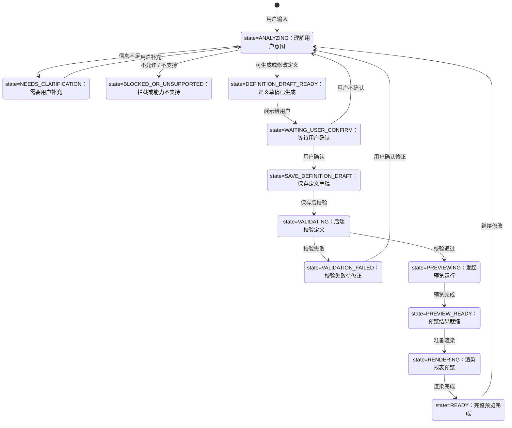

# 智能报表 AI 后端统筹

> 目标：先用一个首功能跑通后端链路和接口契约，再逐步接入真实 AgentScope，避免一开始就做全量后端设计。

---

## 0. 和上游文档的关系

本文件不负责选工具栈，也不负责定义产品功能范围。

上游文档分工如下：

| 文档 | 负责什么 | 本文件怎么使用 |
| --- | --- | --- |
| PRD / 功能清单 | 定义要做哪些功能、用户场景和验收标准 | Backend 按这些能力拆实现任务 |
| `../工具栈选择与讨论.md` | 讨论和确认工具栈，例如 FastAPI、AgentScope、ECharts、Java 后端边界 | Backend 采用其中的后端技术选择，不重复讨论选型 |
| `00_统筹.md` | 把 AI 后端要做的事拆成步骤、接口、FakeAgent、AgentScope 接入和测试样例 | 作为 Backend 实践入口 |

管理原则：**工具栈文档管“选什么和为什么”，PRD / 功能清单管“做什么”，本文件管“AI 后端怎么实现”。**

---

## 1. 首功能选择

首功能先选：**自然语言生成机房耗电量报表草稿**。

原因：

- 输入是自然语言，适合 AI 参与理解和生成。
- 输出可以先做成结构化 `ReportDefinition` 草稿，方便前端展示和后端校验。
- 能覆盖接口字段、返回结构、拦截状态、修正建议、用户确认等基础链路。
- 跑通后可以复制到修改报表、权限拦截、校验修正、结果解释等功能。
- 机房耗电量场景足够具体，方便先做本地假数据集，不依赖真实数据库。

---

## 2. 职责边界

| 模块 | 负责什么 | 不负责什么 |
| --- | --- | --- |
| 前端 | 收集用户输入、展示 AI 回复、展示草稿、展示拦截和修正卡片、让用户确认或拒绝 | 不直接决定权限、不绕过后端校验 |
| FastAPI 后端 | 提供 AI 接口、组织请求响应、调用 FakeAgent / AgentScope、做基础状态流转 | 不替代 Java 后端的正式业务规则 |
| FakeReportAgent | 用固定规则模拟 AI 回复，验证接口契约和流程 | 不验证模型质量 |
| AgentScope | 后续替换 FakeReportAgent，负责真实意图理解和草稿生成 | 不直接发布、不直接写库、不绕过权限 |
| Java 后端 | 权限校验、数据源校验、指标校验、保存草稿、发布报表、正式执行 | 不负责自然语言理解 |

核心原则：AI 负责“不确定的理解和生成”，系统负责“确定的规则和执行”。

---

## 3. 首功能落地步骤

| 步骤 | 做什么 | 目的 |
| --- | --- | --- |
| 1 | 画职责边界 | 先说清楚 AgentScope、后端、前端分别负责什么。 |
| 2 | 定接口输入输出 | 先定义 `AgentRequest`、`AgentResponse`，不要急着写 Agent。 |
| 3 | 列 5 个验收样例 | 用少量典型输入验证生成、修改、拦截、修正等主场景。 |
| 4 | 写 `FakeReportAgent` | 像 mock API 一样先模拟 AI 回复，验证接口字段、前端展示、拦截和修正卡片；暂时不验证模型质量。 |
| 5 | 包 FastAPI 接口 | 先做 `POST /api/agent/chat`，让前端能调通。 |
| 6 | 再接 AgentScope | 等假 Agent 跑通后，把生成草稿和修改建议替换成真实 AgentScope 调用。 |

先写假 Agent 的原因：早期最需要验证的是后台链路和接口契约，而不是模型能力。假 Agent 可以把问题限定在“接口和流程是否正确”；等链路稳定后，再把固定规则替换成 AgentScope，相当于只换“大脑”，不重写整个身体。

---

## 4. 首功能 Agent 链路与状态机

### 4.1 首功能 Agent 链路

第一版先做“自然语言生成机房耗电量报表草稿”，链路按“先确认框架，再取数渲染”推进；实现时先用 Fake Module 跑通，后面再替换成真实 AgentScope、Skill / MCP 和后端数据能力。

```text
用户输入
  ↓
语义分析 Module
  - 拆解用户需求
  - 提炼关键参数
  - 选择初步 visualization
  - 判断是否需要追问 / 拦截
  ↓
报表框架生成 Module
  - 生成 ReportDefinition 草稿框架
  - 先不取真实数据
  - 发给前端预览基本框架
  ↓
用户确认框架
  - 确认：继续取数
  - 不确认：回到语义分析 / 框架生成循环
  ↓
取数 Skill
  - FastAPI 后端能力
  - 按已确认框架和参数取数
  - 返回 JSON、字段说明、单位和数据质量信息
  ↓
Agent 检查取数结果
  - 告诉用户已取到数据
  - 判断是否需要补充说明或提示质量问题
  ↓
渲染 Module
  - 做渲染前 preprocessing / normalization
  - 合并已确认的 ReportDefinition、参数、JSON 数据和数据质量信息
  - 形成本次预览使用的 RunContext / render context
  - 把 JSON 数据填入已确认的 ReportDefinition
  - 前端渲染完整报表
```

### 4.2 状态机跳转

状态机先服务首功能，不追求一次覆盖所有泛化场景。

| 状态 | 触发条件 | 下一步 |
| --- | --- | --- |
| `ANALYZING` | 收到用户自然语言输入 | 进入语义分析 Module，拆解意图、参数、目标区域和基础定义版本。 |
| `NEEDS_CLARIFICATION` | 关键信息不足，例如缺少日期、location、口径 | 向用户追问；用户补充后回到 `ANALYZING`。 |
| `BLOCKED_OR_UNSUPPORTED` | 权限不允许、能力不支持、危险动作或无法处理 | 给出原因和替代建议；不生成定义。 |
| `DEFINITION_DRAFT_READY` | 已能生成首版 `ReportDefinition` 或修改 `ChangeSet` | 返回定义草稿、变更集、假设和 `IntentBinding`。 |
| `WAITING_USER_CONFIRM` | 定义框架或变更已展示给用户 | 用户确认则保存定义草稿；用户不确认则回到 `ANALYZING` 重新生成。 |
| `SAVE_DEFINITION_DRAFT` | 用户接受框架或变更 | 调用定义保存接口，形成新的定义草稿版本。 |
| `VALIDATING` | 定义草稿已保存 | 调用后端校验，检查结构、字段、指标、权限和能力。 |
| `VALIDATION_FAILED` | 后端校验失败 | Agent 解释原因并生成修正建议或 `ChangeSet`。 |
| `PREVIEWING` | 校验通过 | 调用 `ReportRun Preview`，使用正式执行引擎生成预览运行。 |
| `PREVIEW_READY` | 预览运行完成 | 返回 `report_run_id`、结果数据和数据质量信息。 |
| `RENDERING` | 定义和预览结果都已准备好 | 前端按 `ReportDefinition` 和预览结果渲染报表。 |
| `READY` | 完整预览完成 | 用户可以继续修改、保存草稿或进入发布前检查。 |

状态流转图：



### 4.3 AI 后端关注的顶层领域对象

> 本节只列 AI 后端链路需要直接识别、传递或解释的顶层领域对象。`ReportDefinition` 内部字段、区域模型、组件类型、数据计算结构不在这里重复维护；生成和校验时以 `report-definition-v1.md`、`report-definition.schema.json` 和 `02_report-definition解读.md` 为准。

顶层领域对象：

| 对象 | AI 后端怎么用 | 来源 |
| --- | --- | --- |
| `ReportPolicy` | 生成或接收策略草稿；表达周期、触发、启停、允许范围、参数覆盖权限和执行配额。 | 两个源文档 |
| `ReportDefinition` | AI 生成和修改的核心报表草稿；内部结构交给协议和 Schema 约束。 | 两个源文档 |
| `ReportDesignSession` | 保存当前编辑上下文，包括当前定义、选中区域、基础版本、对话和变更记录。 | 两个源文档 |
| `ReportRun` | 预览或正式执行实例；AI 可以触发预览、读取质量结果和预览数据，但不直接执行。 | 两个源文档 |
| `ReportRelease` | 正式发布时的策略版本和定义版本绑定；首功能只需要知道它是正式运行依据。 | 两个源文档 |

运行时派生对象：

| 对象 | AI 后端怎么用 | 归属 |
| --- | --- | --- |
| `RunContext` | 后端运行前解析出的实际对象范围、时间窗口、统计粒度、过滤条件和数据质量策略；AI 只读取解释，不自行生成最终值。 | `ReportRun` |
| `ChangeSet` | 记录一次 AI/用户修改涉及哪些字段、哪些区域、改了什么、没改什么以及修改原因；必须带 `baseDefinitionRevision`，按稳定区域 ID 定位，先校验再生成新草稿。 | 贯穿 `ReportDesignSession`，并沉淀到新的 `ReportDefinition` 草稿版本 / `intentBindings` |

外部后端能力：

| 能力 | AI 后端怎么用 | 不在本节展开的原因 |
| --- | --- | --- |
| `ReportCatalog` / 数据目录 | 通过 Java 后端或受控工具查询可用数据源、字段语义、权限标签和版本。 | 平台级目录能力，不是某一份 `ReportDefinition` 的内嵌对象。 |
| `ReportMetric` / 指标目录 | 通过 Java 后端或受控工具查询可用指标、口径、公式、维度、单位和版本。 | 平台级指标能力，被定义引用，不在统筹文件重复维护。 |

`ReportDefinition` 内部对象，例如 `ReportRegion`、`DatasetDefinition`、`PipelineDefinition`、`DataSpec`、`Component`、`ChartComponent` 等，只在协议、Schema 和解读文档中维护。本文件只规定 AI 后端接口怎么接收、返回、保存、校验和预览这些顶层对象。

---

## 5. 接口草案

### 5.0 接口定位

第 5 章按第 4 章的链路、状态机和领域对象来定义接口，不在这里重复展开 `ReportDefinition` 内部字段。AI 后端只负责对话编排、意图理解、草稿生成、变更建议和结果解释；保存、校验、预览、发布、正式执行和真实取数仍走 Java 后端或受控工具。

| 接口层 | 负责什么 | 不负责什么 |
| --- | --- | --- |
| `POST /api/agent/chat` | 承接用户输入、状态推进、AI 回复，基于 `ReportDesignSession` 生成 `ReportPolicy` 草稿、`ReportDefinition` 草稿或 `ChangeSet` | 不直接查库、不发布、不正式执行 |
| Java 报表接口 | 创建/恢复 `ReportDesignSession`，保存策略草稿、保存定义草稿、校验定义、创建预览 `ReportRun`、发布 `ReportRelease`、查询结果 | 不负责自然语言理解 |
| 受控工具层 | 查询数据目录、指标目录、预览数据和校验结果 | 不绕过用户权限、不开放任意 SQL |

推荐调用关系：

```text
前端工作台
  ↓
Java 业务后端
  - 创建或读取 ReportPolicy 草稿
  - 创建或恢复 ReportDesignSession
  ↓
Python AI 生成服务 /api/agent/chat
  ↓
语义分析 Module / 报表框架生成 Module / Agent 总控
  ↓
Java 后端能力：保存 ReportPolicy 草稿、保存 ReportDefinition 草稿、校验、预览 ReportRun、查询目录和指标
  ↓
渲染 Module：preprocessing / normalization 后返回可渲染结果
```

早期为了跑通链路，可以让前端直接调 `POST /api/agent/chat`；正式接业务系统时，更推荐由 Java 业务后端统一控制用户身份、权限、上下文和可用数据范围，再转发给 AI 生成服务。

### 5.1 对话入口

`POST /api/agent/chat` 是 AI 后端的唯一对话入口。它按第 4 章状态机推进，不按按钮拆多个 AI 接口。

| 输入场景 | 当前状态 | 主要输入 | 期望输出 |
| --- | --- | --- | --- |
| 首次生成 | `ANALYZING` | 用户原话、策略上下文、可选数据目录/指标摘要 | `ReportPolicy` 草稿、`ReportDefinition` 草稿、待确认问题或拦截原因 |
| 用户确认框架 | `WAITING_USER_CONFIRM` | `designSessionId`、定义草稿 ID、用户确认消息 | 保存草稿请求、校验请求或预览请求 |
| 修改草稿 | `READY` / `VALIDATION_FAILED` | 当前定义、`selectedRegionId`、`baseDefinitionRevision`、用户修改要求 | `ChangeSet`、影响说明、是否需要重取数/重渲染 |
| 校验失败修正 | `VALIDATION_FAILED` | 校验结果、当前定义、用户确认 | 修正建议或新的 `ChangeSet` |
| 预览结果解释 | `PREVIEW_READY` / `READY` | `ReportRun` 预览结果、质量摘要、用户追问 | 解释文本、质量提示、可选继续修改建议 |

请求结构只放 AI 编排需要的信息：

```json
{
  "conversationId": "conv_001",
  "state": "ANALYZING",
  "message": "生成 A 机房昨日能耗日报",
  "context": {
    "designSessionId": null,
    "reportPolicyId": null,
    "reportDefinitionId": null,
    "baseDefinitionRevision": null,
    "selectedRegionId": null,
    "projectId": "project_001",
    "subjectRef": "machine_room",
    "subjectId": "room_a"
  },
  "snapshots": {
    "reportPolicy": null,
    "reportDefinition": null,
    "lastChangeSet": null,
    "lastValidationResult": null,
    "lastReportRun": null
  }
}
```

字段约束：

| 字段 | 规则 |
| --- | --- |
| `state` | 必须来自第 4.2 节状态机，AI 只能按允许路径推进 |
| `designSessionId` | 有会话则必传；没有则由 Java 后端创建或恢复 `ReportDesignSession` |
| `baseDefinitionRevision` | 生成 `ChangeSet` 时必传，用于并发编辑校验 |
| `selectedRegionId` | 局部修改时优先传，避免靠数组下标定位区域 |
| `snapshots.reportDefinition` | 可以传完整草稿或服务端摘要；最终仍以 Java 后端保存版本为准 |
| `lastValidationResult` / `lastReportRun` | 用于解释错误、质量问题和预览结果，不作为正式执行依据 |

### 5.2 响应结构

AI 响应必须同时返回“给用户看的话”和“给系统执行的结构化动作”。不要只返回自然语言。

```json
{
  "state": "DEFINITION_DRAFT_READY",
  "reply": "我生成了 A 机房昨日能耗日报草稿，包含总耗电、设备排名、小时趋势、数据质量和分析说明。",
  "designSessionId": "session_001",
  "domainObjects": {
    "reportPolicyDraft": {},
    "reportDefinitionDraft": {},
    "changeSet": null,
    "reportRunPreview": null
  },
  "questions": [],
  "blocks": [],
  "toolRequests": [],
  "uiActions": ["preview_framework", "confirm_framework", "regenerate_framework"]
}
```

| 响应字段 | 含义 |
| --- | --- |
| `state` | 下一状态，对应第 4.2 节状态机 |
| `reply` | 给用户展示的解释、追问、确认或错误说明 |
| `domainObjects.reportPolicyDraft` | 可选；首次生成策略草稿时返回 |
| `domainObjects.reportDefinitionDraft` | 可选；生成或修正报表定义草稿时返回，内部结构以协议和 Schema 为准 |
| `domainObjects.changeSet` | 可选；修改已有定义时返回，必须说明改了什么、没改什么、影响哪些区域 |
| `domainObjects.reportRunPreview` | 可选；预览完成后放运行 ID、状态、质量摘要和结果引用 |
| `questions` | 信息不足时返回追问问题 |
| `blocks` | 权限、能力或安全边界导致无法继续时返回拦截原因 |
| `toolRequests` | 需要 Java 后端或受控工具执行的动作，例如查目录、校验、预览 |
| `uiActions` | 前端下一步按钮或展示动作 |

### 5.3 Java 后端能力接口

AI 后端不直接落库、不直接发布、不直接执行 SQL。涉及权威状态的动作都调用 Java 后端。

| 第 4 章对象 / 阶段 | 建议接口 | AI 后端怎么用 |
| --- | --- | --- |
| `ReportDesignSession` | `POST /smart-report/design-sessions` | 创建或恢复设计会话，拿到当前定义、选中区域、基础版本 |
| `ReportDesignSession` | `POST /smart-report/design-sessions/{id}/messages` | 正式系统可由 Java 后端封装 AI 对话入口 |
| `ReportPolicy` | `POST /smart-report/policies` / `PATCH /smart-report/policies/{id}` | 保存或更新策略草稿；AI 只给候选内容 |
| `ReportDefinition` | `GET /smart-report/definitions/{id}` | 读取当前定义和指定版本 |
| `ReportDefinition` | `PATCH /smart-report/definitions/{id}` | 应用页面修改或已确认 `ChangeSet`，生成新草稿版本 |
| 校验 | `POST /smart-report/definitions/{id}/validate` | 调 Java 后端做结构、业务语义、依赖、权限和能力校验 |
| `ReportRun` 预览 | `POST /smart-report/definitions/{id}/preview` | 创建预览运行，返回 `reportRunId`，预览不进入正式归档统计 |
| `ReportRun` 查询 | `GET /smart-report/runs/{id}` | 查询预览进度、阶段、错误和质量摘要 |
| 结果 | `GET /smart-report/runs/{id}/result` | 获取不可变结果布局与数据，供渲染和解释使用 |
| `ReportRelease` | `POST /smart-report/releases` | 固定策略版本、定义版本和依赖版本；首功能只需要知道它是正式运行依据 |

Java 后端必须控制：用户身份、IAM、租户、字段真实性、指标真实性、单位、执行计划、分页完整性、正式发布和正式执行。

### 5.4 受控工具和外部能力

`ReportCatalog` 和 `ReportMetric` 属于数据分析能力的外部支撑。AI 可以查询摘要，但不能自己编造数据源、字段、指标、公式或权限。

| 能力 | 推荐接口 / 工具 | 用途 | 禁止事项 |
| --- | --- | --- | --- |
| 数据目录 `ReportCatalog` | `POST /smart-report/catalogs/list` / `CatalogTool` | 查询可用数据源、接口能力、字段语义、权限标签和版本 | 不直接连库查元数据，不暴露凭证 |
| 指标目录 `ReportMetric` | `POST /smart-report/metrics/list` / `MetricTool` | 查询可用指标、口径、公式、维度、单位和版本 | 不让模型猜指标口径，不让模型直接写 SQL |
| 定义校验 | `ValidationTool` | 把 Java 校验结果转成解释或修正建议 | 不让模型替代后端校验 |
| 预览运行 | `PreviewTool` | 调 Java 后端创建或查询 `ReportRun Preview` | 不让 AI 服务直接执行生产查询 |

推荐取数方式：

```text
用户登录
  ↓
Java 后端识别用户身份和权限
  ↓
Java 后端给 AI 服务传入已授权上下文
  ↓
Agent 需要目录、指标或预览数据时调用受控工具
  ↓
受控工具再调用 Java 后端查询接口
  ↓
Java 后端只返回该用户有权限看的数据、指标和预览结果
```

### 5.5 状态与动作返回规则

第 5 章接口必须严格服务第 4.2 节状态机。前端不要靠解析自然语言判断下一步，而是使用 `state`、`uiActions`、`toolRequests` 和 `blocks`。

| 状态 | 响应重点 | 允许的下一步 |
| --- | --- | --- |
| `ANALYZING` | 用户意图解析中或刚收到输入 | 生成草稿、追问、拦截 |
| `NEEDS_CLARIFICATION` | 返回 `questions` | 用户补充后回到 `ANALYZING` |
| `BLOCKED_OR_UNSUPPORTED` | 返回 `blocks` 和替代建议 | 结束或用户换需求 |
| `DEFINITION_DRAFT_READY` | 返回 `reportDefinitionDraft` / `changeSet` | 展示框架，等待确认 |
| `WAITING_USER_CONFIRM` | 返回确认按钮和框架摘要 | 保存草稿或重新生成 |
| `SAVE_DEFINITION_DRAFT` | 返回保存动作或 Java 保存请求 | 保存后进入校验 |
| `VALIDATING` | 返回校验请求或校验中状态 | 成功进入预览，失败进入修正 |
| `VALIDATION_FAILED` | 返回校验解释和修正 `ChangeSet` | 用户确认修正后重新分析或保存 |
| `PREVIEWING` | 返回预览 `ReportRun` 请求 / ID | 等待预览完成 |
| `PREVIEW_READY` | 返回预览数据、质量摘要和渲染输入 | 进入渲染 |
| `RENDERING` | 返回 render context 或结果引用 | 渲染完成进入 `READY` |
| `READY` | 返回完整预览、可继续修改或保存 | 继续修改、保存草稿、发布前检查 |

### 5.6 最小接口样例

首次生成请求：

```json
{
  "conversationId": "conv_001",
  "state": "ANALYZING",
  "message": "生成 A 机房昨日能耗日报，包含总耗电、设备排名和趋势分析",
  "context": {
    "designSessionId": null,
    "reportPolicyId": null,
    "reportDefinitionId": null,
    "baseDefinitionRevision": null,
    "selectedRegionId": null,
    "projectId": "project_001",
    "subjectRef": "machine_room",
    "subjectId": "room_a"
  }
}
```

首次生成响应：

```json
{
  "state": "WAITING_USER_CONFIRM",
  "reply": "已生成 A 机房昨日能耗日报草稿，请确认是否按这个框架继续校验和预览。",
  "designSessionId": "session_001",
  "domainObjects": {
    "reportPolicyDraft": {
      "name": "A 机房能耗日报"
    },
    "reportDefinitionDraft": {
      "schemaVersion": "1.0",
      "metadata": {
        "name": "A 机房能耗日报"
      },
      "regions": []
    },
    "changeSet": null,
    "reportRunPreview": null
  },
  "questions": [],
  "blocks": [],
  "toolRequests": [
    {
      "type": "SAVE_DEFINITION_DRAFT",
      "target": "JavaReportService"
    }
  ],
  "uiActions": ["preview_framework", "confirm_framework", "regenerate_framework"]
}
```

修改草稿响应：

```json
{
  "state": "DEFINITION_DRAFT_READY",
  "reply": "我会把趋势图改为最近 7 天，并保持总耗电卡片仍按昨日统计。",
  "designSessionId": "session_001",
  "domainObjects": {
    "changeSet": {
      "baseDefinitionRevision": 3,
      "changed": [
        {
          "regionId": "region_energy_trend",
          "path": "/regions/region_energy_trend/context/timeWindow",
          "summary": "改为最近 7 天"
        }
      ],
      "unchanged": [
        {
          "regionId": "region_total_energy",
          "summary": "总耗电卡片仍使用昨日窗口"
        }
      ],
      "impact": ["需要重新解析窗口", "需要重取趋势图数据", "不影响昨日总耗电卡片"]
    }
  },
  "questions": [],
  "blocks": [],
  "uiActions": ["show_diff", "accept_change", "reject_change"]
}
```

---

## 6. 验收样例

第 6 章用于验证第 4 章状态机和第 5 章接口草案能不能跑通。验收重点不是模型回答是否华丽，而是状态是否正确、领域对象是否齐全、是否调用受控能力、是否守住 AI 和 Java 的边界。

### 6.1 样例总览

| 样例 | 用户输入 | 初始状态 | 期望状态 | 关键对象 | 工具 / 接口 | 验收点 |
| --- | --- | --- | --- | --- | --- | --- |
| 1. 正常生成 | 生成 A 机房昨日能耗日报，包含总耗电、设备排名和趋势分析 | `ANALYZING` | `WAITING_USER_CONFIRM` | `ReportPolicy`、`ReportDefinition`、`ReportDesignSession` | `CatalogTool`、`MetricTool` | 能生成策略草稿和定义草稿，并等待用户确认 |
| 2. 信息不足 | 帮我看异常设备 | `ANALYZING` | `NEEDS_CLARIFICATION` | `ReportDesignSession` | 无或 `CatalogTool` | 能追问异常类型、对象范围和时间窗口 |
| 3. 权限越界 | 帮我看所有项目的能耗排名 | `ANALYZING` | `BLOCKED_OR_UNSUPPORTED` | `ReportDesignSession` | 权限检查 / Java 后端 | 不生成越权草稿，不泄露不可见对象 |
| 4. 数据能力不支持 | 帮我看分钟级历史能耗 | `ANALYZING` | `BLOCKED_OR_UNSUPPORTED` 或 `NEEDS_CLARIFICATION` | `ReportDesignSession` | `CatalogTool` | 能说明当前数据粒度不支持，并给可行替代方案 |
| 5. 修改已有草稿 | 把趋势图改成最近 7 天 | `WAITING_USER_CONFIRM` | `DEFINITION_DRAFT_READY` | `ChangeSet`、`ReportDefinition`、`ReportDesignSession` | 可选 `CatalogTool`、`MetricTool` | 能展示改了哪里、没改哪里、影响哪些区域 |
| 6. 用户拒绝后重新生成 | 不要趋势图，改成只要总耗电和设备排名 | `WAITING_USER_CONFIRM` | `DEFINITION_DRAFT_READY` | `ReportDefinition`、`ReportDesignSession`、`ChangeSet` | 可选 `CatalogTool`、`MetricTool` | 能基于反馈重新生成草稿，不直接覆盖旧版本 |

### 6.2 样例 1：正常生成机房能耗日报

| 项目 | 期望 |
| --- | --- |
| 用户输入 | `生成 A 机房昨日能耗日报，包含总耗电、设备排名和趋势分析` |
| 状态流转 | `ANALYZING` -> `DEFINITION_DRAFT_READY` -> `WAITING_USER_CONFIRM` |
| 生成对象 | `ReportPolicy` 草稿、`ReportDefinition` 草稿、`ReportDesignSession` |
| 外部能力 | 查询可用能耗数据源、查询总耗电指标 |
| 前端展示 | 框架预览、确认按钮、重新生成按钮 |
| 验收标准 | 草稿不包含凭证；数据源和指标只引用已登记能力；不触发正式取数、预览、发布或执行 |

预期 `ReportDefinition` 至少包含：

- 报告标题区域。
- 昨日总耗电指标卡。
- 设备耗电排名表。
- 小时趋势图。
- 数据质量区域。
- 分析说明区域。

### 6.3 样例 2：信息不足需要追问

| 项目 | 期望 |
| --- | --- |
| 用户输入 | `帮我看异常设备` |
| 状态流转 | `ANALYZING` -> `NEEDS_CLARIFICATION` |
| 生成对象 | 可以创建 `ReportDesignSession`，但不生成正式 `ReportDefinition` 草稿 |
| 追问内容 | 异常类型、统计对象、时间窗口、展示方式 |
| 验收标准 | 不胡乱假设异常口径；不直接生成无法校验的报表定义 |

示例追问：

```text
你想看哪类异常设备？例如能耗异常、离线异常、告警异常。还需要确认统计范围和时间窗口。
```

### 6.4 样例 3：权限越界必须拦截

| 项目 | 期望 |
| --- | --- |
| 用户输入 | `帮我看所有项目的能耗排名` |
| 状态流转 | `ANALYZING` -> `BLOCKED_OR_UNSUPPORTED` |
| 生成对象 | 不生成可执行 `ReportDefinition` 草稿 |
| 后端能力 | Java 后端或权限上下文返回用户只能查看的项目范围 |
| 验收标准 | 不返回不可见项目 ID、名称、指标值；给出可替代范围，例如“当前项目”或“有权限项目” |

### 6.5 样例 4：数据能力不支持

| 项目 | 期望 |
| --- | --- |
| 用户输入 | `帮我看 A 机房分钟级历史能耗` |
| 状态流转 | `ANALYZING` -> `BLOCKED_OR_UNSUPPORTED` 或 `NEEDS_CLARIFICATION` |
| 外部能力 | `CatalogTool` 查询能耗数据源支持的时间粒度 |
| 验收标准 | 如果目录只有小时或日粒度，必须说明不支持分钟级；可以建议改成小时趋势或日趋势 |

不能做的事：

- 不能让模型反向编造分钟级数据。
- 不能把日汇总拆成分钟曲线。
- 不能跳过数据目录能力校验。

### 6.6 样例 5：修改已有草稿

| 项目 | 期望 |
| --- | --- |
| 用户输入 | `把趋势图改成最近 7 天` |
| 初始上下文 | 已有 `ReportDesignSession`、`ReportDefinition`、`selectedRegionId` 或可定位趋势图区域 |
| 状态流转 | `WAITING_USER_CONFIRM` -> `DEFINITION_DRAFT_READY` -> `WAITING_USER_CONFIRM` |
| 生成对象 | `ChangeSet` |
| 验收标准 | `ChangeSet` 必须带 `baseDefinitionRevision`；按稳定区域 ID 定位；说明总耗电卡片不受影响 |

`ChangeSet` 至少表达：

- 改了趋势图的 `context.timeWindow`。
- 没改总耗电卡片的昨日窗口。
- 影响范围是趋势图区域定义发生变化，后续如果进入预览才需要重取数、重算、重渲染。
- 用户接受后再由 Java 后端应用并生成新草稿版本。

### 6.7 样例 6：用户拒绝后重新生成

| 项目 | 期望 |
| --- | --- |
| 用户输入 | `不要趋势图，改成只要总耗电和设备排名` |
| 初始上下文 | 已有待确认的 `ReportDefinition` 草稿 |
| 状态流转 | `WAITING_USER_CONFIRM` -> `DEFINITION_DRAFT_READY` -> `WAITING_USER_CONFIRM` |
| 生成对象 | 新的 `ReportDefinition` 草稿或基于旧草稿的 `ChangeSet` |
| 验收标准 | 能说明删除了趋势图区域，保留总耗电和设备排名；旧草稿不被直接覆盖，需用户确认后再保存新版本 |

后续能力不进入本次验收：

- 定义校验失败后的自动修正。
- 创建 `ReportRun Preview` 并渲染完整报表。
- 基于预览结果解释“为什么耗电升高”。

### 6.9 通用验收规则

| 规则 | 说明 |
| --- | --- |
| 状态必须可追踪 | 每个样例都要能落到第 4.2 节状态机 |
| 对象必须可定位 | 涉及修改时必须有 `designSessionId`、`baseDefinitionRevision` 和稳定区域 ID |
| AI 不直接执行 | AI 不直接查库、不写库、不发布、不正式执行 |
| 能力必须受控 | 数据源、指标、函数、组件和插件必须来自目录或注册表 |
| 失败必须可解释 | 权限、能力、校验、质量问题都要能给用户解释原因和下一步 |
| 草稿必须可审查 | AI 生成的 `ReportPolicy`、`ReportDefinition` 和 `ChangeSet` 必须能展示给用户确认后再保存 |

---

## 7. 后端文件规划

本阶段只服务“自然语言生成 / 修改报表草稿”闭环，不实现完整预览运行、正式发布、正式执行和结果解释。目录规划要围绕第 6 章验收样例，不提前铺满全功能。

### 7.1 目录结构

```text
backend/
  00_统筹.md
  app/
    main.py
    schemas/
      agent.py
      report_policy.py
      report_definition.py
      change_set.py
      edit_plan.py
    data/
      catalog_mock.py
      metric_mock.py
    agents/
      fake_report_agent.py
      agentscope_report_agent.py
      prompts/
        report_generation.md
    tools/                  ← 13 个工具，统一收在这里，一个工具一个文件
      base.py               ← 统一契约 + 节点白名单常量
      registry.py           ← 注册 / Toolkit 构建 / 契约校验 / 中台清单导出
      context.py            ← ToolContext（授权范围 + 草稿状态）
      submission.py         ← 终结工具提交槽
      schemas.py            ← 终结工具载荷模型
    services/
      agent_service.py
      report_draft_service.py
      catalog_mock_service.py
      metric_mock_service.py
      context_engine.py
      template_edit_engine.py
      scope_service.py      ← 项目 / 实例可见性规则
      session_service.py
    routers/
      agent.py
      mock_capability.py
  tests/
    test_fake_report_agent.py
    test_agent_api.py
    test_acceptance_cases.py
    test_tools.py
    test_react_stage0.py
```

### 7.2 文件职责

| 文件 | 负责什么 | 不负责什么 |
| --- | --- | --- |
| `app/main.py` | 创建 FastAPI 应用、注册路由、提供健康检查 | 不写业务逻辑 |
| `schemas/agent.py` | 定义 `AgentRequest`、`AgentResponse`、状态枚举、`uiActions`、`toolRequests` | 不定义完整 `ReportDefinition` 协议 |
| `schemas/report_policy.py` | 定义首功能需要的 `ReportPolicy` 草稿字段，例如名称、范围、时间窗口候选 | 不实现调度、启停、执行配额 |
| `schemas/report_definition.py` | 定义首功能简化版 `ReportDefinition` 草稿结构，能表达标题、指标卡、表格、趋势图等区域 | 不覆盖完整 `report-definition-v1.md` 全量字段 |
| `schemas/change_set.py` | 定义修改草稿时的 `ChangeSet`，记录改了哪里、没改哪里、影响范围和 `baseDefinitionRevision` | 不直接修改数据库 |
| `agents/fake_report_agent.py` | 用固定规则模拟 AI，覆盖第 6 章验收样例 | 不验证真实模型能力 |
| `agents/agentscope_report_agent.py` | 跑 AgentScope 的 ReAct 内核，用受控工具查事实、用终结工具提交结论 | 不直接改草稿、不做状态转移判定 |
| `tools/` | 13 个受控工具，统一契约，按节点白名单下发给模型 | 不绕过授权范围直接取数 |
| `services/agent_service.py` | 编排请求、状态流转、规则编辑快路径、Agent 调用和响应包装。**AgentService 本质就是一个 ChatOrchestrator**（状态机执行器），不是 Agent、不依赖 AgentScope | 不直接查库、不发布、不执行报表 |
| `services/report_draft_service.py` | 组装机房能耗日报的策略草稿、定义草稿和修改草稿 | 不取真实业务数据 |
| `services/catalog_mock_service.py` | 模拟数据目录能力，返回可用数据源、字段、粒度和权限摘要 | 不连接真实数据库 |
| `services/metric_mock_service.py` | 模拟指标目录能力，返回总耗电等指标口径、单位、维度和版本 | 不编译 SQL |
| `routers/agent.py` | 暴露 `POST /api/agent/chat` | 不拆多个 AI 对话接口 |
| `routers/mock_capability.py` | 暴露调试用 mock 目录和指标接口 | 不作为正式 Java 后端接口 |
| `tests/test_agent_api.py` | 测试接口状态码、请求响应结构和状态流转 | 不测真实模型质量 |
| `tests/test_fake_report_agent.py` | 测试 FakeAgent 在典型输入下返回正确草稿、追问或拦截 | 不测 FastAPI 路由 |
| `tests/test_acceptance_cases.py` | 覆盖第 6 章验收样例 | 不测预览运行和正式发布 |

### 7.3 推进顺序

| 步骤 | 做什么 | 目的 |
| --- | --- | --- |
| 1 | 写 `schemas/agent.py`、`report_policy.py`、`report_definition.py`、`change_set.py` | 先固定接口出入参和草稿对象形状 |
| 2 | 写 `catalog_mock_service.py` 和 `metric_mock_service.py` | 让 FakeAgent 不靠硬猜数据源和指标 |
| 3 | 写 `report_draft_service.py` | 集中生成机房能耗日报草稿，避免散落在路由里 |
| 4 | 写 `fake_report_agent.py` | 用规则覆盖正常生成、追问、拦截、修改和重新生成 |
| 5 | 写 `agent_service.py` 和 `routers/agent.py` | 包装成 `POST /api/agent/chat` |
| 6 | 写第 6 章验收样例对应测试 | 确认状态、对象、工具调用和边界都能跑通 |

### 7.4 本阶段接口

| 接口 | 作用 |
| --- | --- |
| `GET /health` | 健康检查。 |
| `POST /api/agent/chat` | AI 对话入口，生成或修改 `ReportPolicy` / `ReportDefinition` 草稿。 |
| `GET /api/mock/catalogs` | 调试用数据目录 mock，返回可用数据源、字段和粒度。 |
| `GET /api/mock/metrics` | 调试用指标目录 mock，返回可用指标、口径、单位和维度。 |

本阶段不做：

- 不实现 `ReportRun Preview`。
- 不实现 `ReportRelease` 发布。
- 不实现真实 Java 后端落库。
- 不实现真实数据查询和 SQL 编译。
- 不实现预览结果解释。

---

## 8. 从首功能扩展到全功能

核心节奏：先用一个功能打样，解决接口字段、返回结构、前端展示、AgentScope 输出约束等基础问题；首功能稳定后，再复制到其他功能，最后整体调试。

| 阶段 | 做什么 | 目的 |
| --- | --- | --- |
| 1 | 先选一个首功能 | 例如“自然语言生成报表草稿”，不要一开始全量设计所有接口。 |
| 2 | 对首功能走完：功能选择、职责边界、落地步骤、Agent 链路、接口草案和验收样例 | 跑通边界、接口、验收样例、假 Agent、FastAPI、AgentScope。 |
| 3 | 沉淀数据流和业务流 | 把首功能跑通后的请求、响应、前端展示、后端处理链路画清楚。 |
| 4 | 复制到其他功能 | 按同一套方法扩展到修改报表、权限拦截、校验修正、结果解释等功能。 |
| 5 | 做整体联调 | 所有小闭环都跑通后，再检查跨功能状态、上下文、权限和异常处理。 |

首功能跑通后，建议沉淀一张数据流图，并回看第 4 章业务流和状态机是否需要修正，作为后续扩展的模板。数据流图不是所有 AI 功能都必须画，但本功能涉及结构化草稿、会话上下文、目录/指标摘要、后端校验和多对象状态，画清楚会显著降低后续联调成本。

数据流关注“数据怎么在模块之间传”：

```text
用户输入
  -> AgentRequest
  -> ReportDesignSession 上下文
  -> Catalog / Metric 摘要
  -> FakeAgent / AgentScope
  -> ReportPolicy 草稿
  -> ReportDefinition 草稿 / ChangeSet
  -> AgentResponse
  -> 前端框架预览和确认动作
```

业务流关注“用户和系统状态怎么推进”：

```text
用户提出需求
  -> AI 生成草稿
  -> 用户确认 / 修改 / 拒绝
  -> 保存新草稿版本
  -> 后续再进入校验、预览、发布和执行
```

扩展原则：先用一个小闭环打样，再把同一套边界、状态机和验收方式复制到更多能力。不要在首功能还没跑通时提前实现预览、发布、执行、导出等完整链路。

| 方法 | 说明 |
| --- | --- |
| 先闭环再扩展 | 先把“自然语言 -> 策略草稿 + 定义草稿 -> 用户确认”跑通，再接入更多功能 |
| 先 Fake 再真实 | 先用 FakeAgent 和 mock 目录/指标验证接口契约，再替换 AgentScope 和 Java 后端真实能力 |
| 先边界再智能 | 先固定 AI 不能做什么、Java 必须控制什么，再提升生成质量 |
| 先验收再实现 | 每加一个能力，先写验收样例，再补接口和代码 |
| 先单点再联调 | 每个小闭环独立稳定后，再做跨状态、跨对象、跨权限的整体联调 |

后续扩展时，仍按第 4 章的 top-level domain object 来拆：先判断新增能力主要影响 `ReportPolicy`、`ReportDefinition`、`ReportDesignSession`、`ReportRun` 还是 `ReportRelease`，再决定接口和测试怎么加。

---

## 9. 后续 Backend 子文档

后续不要把所有细节继续堆在 `00_统筹.md`，建议按步骤拆：

| 文档 | 负责什么 |
| --- | --- |
| `01_接口协议.md` | 详细定义 `AgentRequest`、`AgentResponse`、`ReportDraft`、状态枚举和错误结构。 |
| `02_FakeAgent验收样例.md` | 详细写 5-10 个输入样例、期望状态、期望返回和断言方式。 |
| `03_FastAPI落地步骤.md` | 详细写 FastAPI 路由、服务层、目录结构、启动和测试方式。 |
| `04_AgentScope接入方案.md` | 等 FakeAgent 跑通后，再写 AgentScope 的接入方式和替换边界。 |

`00_统筹.md` 只保留方向、边界、顺序和文档索引，不继续承载所有实现细节。
