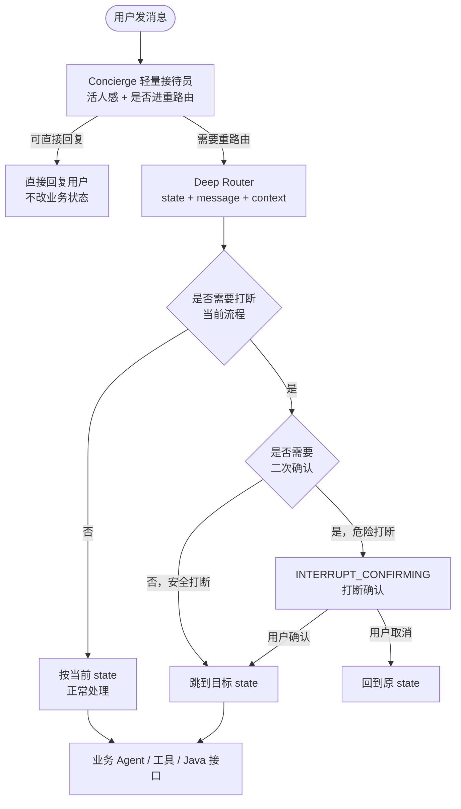
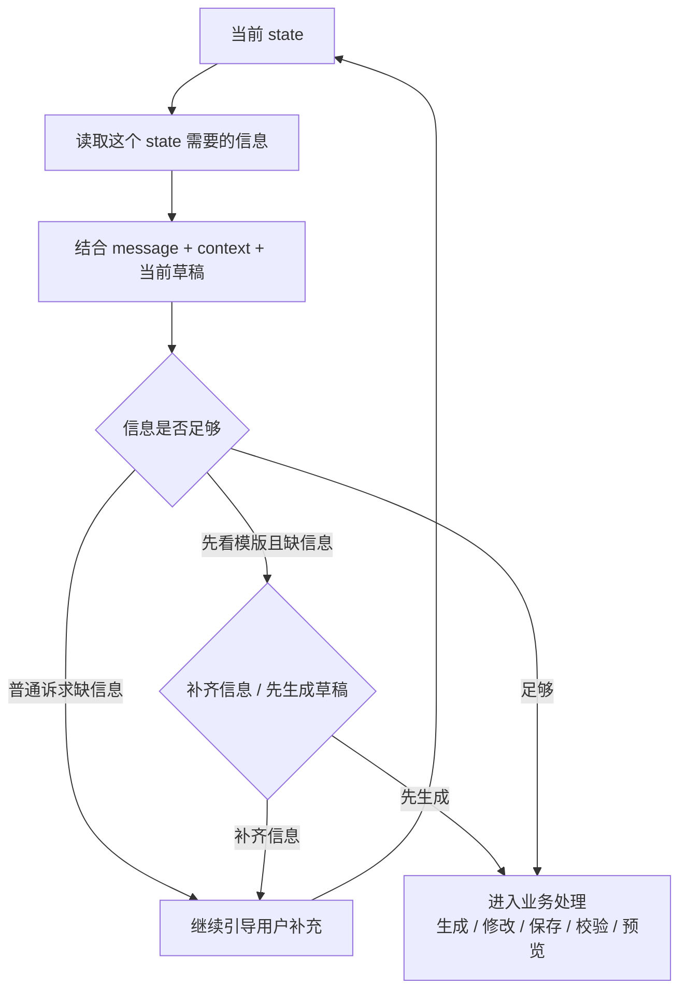

# 功能盘点（按状态机）

> 这份文档从**用户视角**盘点状态机各节点要做什么、现在做到哪、还差什么。
>
> 协议字段、接口格式这些放在 `04_AgentScope接入方案.md` 里，不在这里重复。
>
> 阅读顺序：先看状态机全景图 → ContextEngine 全局路由 → 按节点一个个看。

***

## 状态机全景

```mermaid
flowchart TD
    Start([用户发消息]) --> A1[1 ANALYZING<br/>理解用户想做什么]

    A1 -->|信息不足| A2[2 NEEDS_CLARIFICATION<br/>追问]
    A1 -->|权限/能力拦截| A3[3 BLOCKED_OR_UNSUPPORTED<br/>拦截]
    A1 -->|可以生成| A4[4 DEFINITION_DRAFT_READY<br/>草稿已出]

    A2 -->|用户补充回答| A1

    A3 -->|用户选替代方案| A1
    A3 -->|用户放弃| EndX([结束])

    A4 --> A5[5 WAITING_USER_CONFIRM<br/>等用户确认]

    A5 -->|用户要改/编辑草稿| A5E[5.5 USER_EDITING_TEMPLATE<br/>用户编辑模版]
    A5 -->|用户重做/追问| A1
    A5 -->|用户确认| A6[6 SAVE_DEFINITION_DRAFT<br/>保存草稿]

    A5E -->|编辑完成，继续确认| A5
    A5E -->|用户确认当前模版| A6
    A5E -->|重做/复杂修改| A1

    A6 -->|保存成功| A7[7 VALIDATING<br/>后端校验]
    A6 -->|保存失败| A3

    A7 -->|校验通过| A9[9 PREVIEWING<br/>跑预览]
    A7 -->|校验失败| A8[8 VALIDATION_FAILED<br/>校验失败]

    A8 -->|用户采纳修正| A1

    A9 --> A10[10 PREVIEW_READY<br/>预览就绪]
    A10 --> A11[11 RENDERING<br/>渲染报表]
    A11 --> A12[12 READY<br/>完成]

    A12 -->|用户继续改| A1
    A12 -->|用户发布/结束| EndX

    classDef done fill:#d4edda,stroke:#28a745,stroke-width:2px
    classDef half fill:#fff3cd,stroke:#ffc107,stroke-width:2px
    classDef todo fill:#f8d7da,stroke:#dc3545,stroke-width:2px

    class A1,A2,A4,A5,A5E half
    class A3,A6,A7,A9,A10,A11,A12 done
    class A8 half
```



> 图例：🟩 已跑通 / 🟨 半实现 / 🟥 待实现
>
> 当前阶段节点 6-12 全部用 Mock 实现：保存走内存版 DefinitionSaveService；校验走 Python 本地 validation\_service；预览走 mock\_data\_service 产确定性假数据（机房 A 10 台设备 + 24 小时趋势 + 质量 + 异常）；渲染走前端 ECharts。Java 真实服务接入后替换掉对应 service 即可。

***

## ContextEngine 全局路由

ContextEngine 不画进主状态机图里。它是**每次用户发消息后的第一层判断**，负责判断这句话是继续当前流程，还是要打断当前流程。

实际实现分两层：先由轻量 Concierge 承接用户，判断是否需要进入重路由；复杂句子才进入重 ContextEngine。

| 层                       | 做什么                                | 什么时候返回                                                        |
| ----------------------- | ---------------------------------- | ------------------------------------------------------------- |
| Concierge 轻量接待员         | 活人感回复、快速判断是否需要重路由                  | “你好 / 在吗 / 你能做什么”这类不改变业务状态的话，直接回复                             |
| Deep Router 重路由         | 判断是否打断流程、是否缺信息、目标 state 是什么        | 修改、确认、取消、重做、追问当前草稿、危险打断                                       |
| Template Edit Intent 模式 | 仅在草稿编辑语境下，把用户的编辑话术拆成结构化 `EditPlan` | `USER_EDITING_TEMPLATE` 下用户说“把设备耗电排名改成柱状图 / 删掉趋势图 / 标题改成 xxx” |
| 业务 Agent / 工具 / Java    | 真正生成、修改、保存、校验、预览                   | Deep Router 判断可以进入业务处理时                                       |



**核心规则**

| 规则                                  | 说明                                                                 |
| ----------------------------------- | ------------------------------------------------------------------ |
| 任意状态收到用户新消息时，先经过 ContextEngine      | 不再只服务 `WAITING_USER_CONFIRM`                                       |
| 如果是安全打断，直接跳到目标状态                    | 例如等确认时说“昨日总耗电删掉”，可以直接进入修改流程                                        |
| 如果是危险打断，先进入 `INTERRUPT_CONFIRMING`  | 例如后端正在校验、预览正在运行、草稿还没保存                                             |
| 如果不需要打断，按当前状态正常处理                   | 例如追问状态下用户正常补充信息                                                    |
| 必选下拉尚未提交时禁止自由文本跳转                     | 前端锁定输入，后端先校验待选项，不把非候选答案交给 ContextEngine                         |
| 只有进入草稿编辑语境时才启用 Template Edit Intent | 主入口是 `USER_EDITING_TEMPLATE`；可兼容 `WAITING_USER_CONFIRM` 下用户直接说修改要求 |
| ContextEngine 只拆解意图，不直接改草稿          | 输出结构化 `EditPlan`；实际修改由 `TemplateEditEngine` 执行                     |

**运行中断（不新增 state）**：AI 思考中提供“停止生成”。前端取消当前请求/流、忽略迟到响应及已排队的 `__advance__`，恢复输入；保留上一份已确认的草稿，不把未完成结果写进会话。取消请求不等于撤销已经完成的保存、校验等后端副作用；真正在服务端停止长任务需另接任务取消能力。

**停止后继续（已实现，页面内）**：停止普通对话请求时，在当前页面内保存原始 `message`、`state`、上下文和草稿快照；输入“继续工作 / 继续上一条 / 继续刚才”会换新 `conversationId` 重新执行原请求，并用 `resumeOfConversationId` 关联日志，不表示从模型中途续算。改发其他需求或清空会话会丢弃待恢复任务；刷新页面也不会保留。确认选项及 `__advance__` 等可能产生副作用的操作禁止自动重放；没有待恢复任务的“继续工作”不能进入报表生成。请求和阶段日志保存在 `~/Library/Logs/haewu-ai-report/backend.log`，按大小轮转。

**调试观测（已完成）**

Workbench 已接入 `/api/agent/chat/stream`，每次请求都会在对话区展示一张 `Debug Trace` 卡片，方便定位卡在哪个节点。

| 打印内容             | 说明                                                                                                                        |
| ---------------- | ------------------------------------------------------------------------------------------------------------------------- |
| 全链路耗时            | 每个 stage 都带 `elapsedMs`，表示从本次请求进入 Router 到当前 stage 的耗时                                                                    |
| 当前 state         | 打印请求入站 state、响应 state、自动推进的 from/to state                                                                                 |
| ContextEngine 进度 | 展示 `context_route_start`、`concierge_start`、`concierge_decision`、`deep_route_start`、`deep_route_done`、`context_route_done` |
| 路由决策             | 展示 intent、action、targetState、ready、missingInfo、reason                                                                     |
| 是否进入业务 Agent     | 只有真正进入业务 Agent 时才会出现 `business_agent_start` / `business_agent_done`，并打印 Agent 实现类                                         |
| 自动推进节点           | `__advance__` 会打印 validation / preview / render 等节点的 start / done 和 stepElapsedMs                                         |
| 流式模型输出           | Concierge / Deep Router 的流式 chunk 会合并显示输出字符数，避免刷屏                                                                         |

**Debug Trace 交互增强（已完成）**

Debug Trace 卡片已经能展示全链路日志，但交互上有两个体验问题：一是处理过程中新内容往下追加，用户想看最新一行必须自己手动滚动；二是卡片只能整体铺开，没法像 Trae 那样点箭头收起来。这两个能力已补齐。

**问题 1：处理中看不到最新一行**

现象是卡片在持续往下追加 stage 行，但视口停在旧位置，新内容长在下面看不到。根因有两层：

| 层次         | 现状                                                                                             | 问题                                                                                  |
| ---------- | ---------------------------------------------------------------------------------------------- | ----------------------------------------------------------------------------------- |
| 卡片内层滚动容器 | `.debug-rows` 有 `max-h-56 overflow-y-auto`，每条事件追加后只调用了 `scrollChatBottom()`（`workbench.js:341 / 358`） | `scrollChatBottom()` 滚的是外层对话区 `#chat-scroll`，内层容器自己的 `scrollTop` 从没被设置，新行追加在内层底部但视口不动 |
| 外层对话区     | 每条事件都无条件把 `#chat-scroll` 拉到最底                                                     | 没有“用户已上滑就暂停自动滚动”的保护，用户想回看上一条 stage 时会被强行拽回底部 |

**目标行为**：请求进行中自动跟随最新内容，用户主动上滑后立刻停止跟随并给出“回到底部”提示，用户回到底部后恢复跟随。

**功能点**

| 序号 | 功能                                | 说明                                                                                                          | 状态  |
| -- | --------------------------------- | ----------------------------------------------------------------------------------------------------------- | --- |
| 1  | 卡片内层跟随最新行                     | 每条 stage / chunk 追加后，把 `.debug-rows` 的 `scrollTop` 同步到 `scrollHeight`，保证新行在卡内可见                | 已完成 |
| 2  | 外层对话区贴底跟随                    | 仅在“贴底状态”时才滚动外层 `#chat-scroll`；贴底判定用 `scrollHeight - scrollTop - clientHeight <= 阈值`（48px）    | 已完成 |
| 3  | 用户上滑暂停跟随                     | 用户向上滚动即置为“已脱离底部”，后续事件不再抢滚动位置                                                 | 已完成 |
| 4  | “回到底部”提示                      | 脱离底部时在对话区右下角显示悬浮按钮，点击立刻回到底部并恢复跟随                                          | 已完成 |
| 5  | 回到底部后恢复跟随                   | 贴底后自动恢复自动跟随，不需要用户再点一次                                                                    | 已完成 |
| 6  | 流式输出展开时跟随                   | 展开“查看流式输出”后，内容变高需要继续贴底；折叠后恢复卡片高度                                                  | 已完成 |
| 7  | 折叠状态下新增事件给出提示             | 卡片被折叠时新增了 stage 行，标题栏显示未读行数（如 `+3`），避免“折叠中漏看”                                    | 已完成 |
| 8  | 请求结束保持最终位置                   | 请求结束（done / cancelled / failed）后不再自动滚动，保持用户最后看到的视口                                      | 已完成 |

**实现要点**

| 事项        | 说明                                                                                                                                                             |
| --------- | -------------------------------------------------------------------------------------------------------------------------------------------------------------- |
| 双层贴底判定  | 外层 `#chat-scroll` 阈值 48px，内层 `.debug-rows` 阈值 16px，两者各自独立维护 `stick` 状态，内层跟随不会带动外层                                                   |
| 贴底后恢复    | 内层监听自身 `scroll` 事件实时重算贴底状态，用户手动滚回底部即自动恢复跟随，无需额外点击                                                                          |
| 高度变化补偿  | `model_chunk` 分支会重建行内 `innerHTML`，行高在滚动之后才变化（实测差 8~10px 导致末尾露不全）；用 `ResizeObserver` 监听每行高度变化后重新贴底解决                     |
| 气泡高度补偿  | 外层对话区同样存在“内容追加后高度才提交”的问题，用 `ResizeObserver` 监听每个气泡的高度变化后重新贴底                                                                    |
| 用户消息强制贴底 | 用户主动发消息时强制滚到底部（`scrollChatBottom(true)`），避免新回复出现在视口外                                                             |

**问题 2：卡片不能折叠**

现状是 `appendDebugTrace`（`workbench.js:232-256`）外层是普通 `div.debug-card`，只有卡片内部每一行用原生 `<details>`（`renderDebugParams` 的“关键参数”、`model_chunk` 的“查看流式输出”，见 `workbench.js:302 / 336`），整卡本身没有收起能力。

**目标行为**：像 Trae 那样，卡片标题行右侧有一个小箭头，点击标题行或箭头可以折叠 / 展开整张卡片；折叠后只保留标题栏（图标 + 标题 + 状态徽标 + 耗时 + 未读行数）。

**功能点**

| 序号 | 功能                             | 说明                                                                                              | 状态  |
| -- | ------------------------------ | ----------------------------------------------------------------------------------------------- | --- |
| 1  | 标题行加可点击箭头                  | 用 `mdi:chevron-down` 图标配 CSS 旋转表示展开 / 收起态，跟随项目现有 `iconify-icon` 用法                | 已完成 |
| 2  | 点击标题行或箭头切换折叠            | 标题行整体改为 `<button>`，命中区域包含图标、标题、状态徽标、行数、耗时、箭头                              | 已完成 |
| 3  | 折叠 / 展开动画                  | 内容区用 `grid-template-rows: 1fr → 0fr` 过渡（CSS Grid 高度动画），箭头同步 `rotate(-90deg)`；样式加在 `workbench.html` 内联 `<style>` | 已完成 |
| 4  | 折叠后保留关键信息                 | 标题栏仍显示标题、状态徽标（running / done / cancelled / failed）、总耗时、行数、未读徽标                | 已完成 |
| 5  | 折叠状态在流式追加中保持            | 折叠态存在卡片自身的 `is-collapsed` class 上，`model_chunk` 重建行内 `innerHTML` 不影响卡片级状态          | 已完成 |
| 6  | 默认展开策略                     | 请求进行中默认展开（用户要看实时进度）；请求结束后可自动收成一行摘要，是否自动收起用开关控制，默认不自动收        | 已完成 |
| 7  | 多张卡片折叠状态互不影响             | 每张 Debug Trace 卡片独立保存展开态（各自 class 与 `_readRows`），不共用一个全局标记                      | 已完成 |
| 8  | 与 `<details>` 原生范式保持一致        | 行内折叠继续沿用原生 `<details>` / `<summary>` 写法，卡片级折叠用原生 `<button>` + CSS Grid，不引入第三方折叠库 | 已完成 |

**实现要点**

| 事项        | 说明                                                                                                                             |
| --------- | ---------------------------------------------------------------------------------------------------------------------------------- |
| 标题行语义    | 标题行由 `<div>` 改为 `<button type="button">`，自带键盘可达性与 `aria-expanded` 状态                                            |
| 折叠动画载体  | 内容区外层 `.debug-body` 用 `display: grid` + `grid-template-rows` 过渡到 `0fr`，内层 `.debug-body-inner` 设 `overflow: hidden; min-height: 0`，实现不定高内容的平滑收起 |
| 未读行数计算  | 以「总行数 − 已读行数」计算，展开时把已读行数同步为当前总行数，折叠期间新增的行会累计成 `+N` 徽标                              |

**涉及文件**

| 文件                                            | 改动点                                                                                          |
| --------------------------------------------- | ------------------------------------------------------------------------------------------- |
| `frontend/pages/workbench.js`                  | `scrollChatBottom()` 改为贴底条件滚动；新增 `scrollDebugRows()` / `refreshDebugCard()` / `setDebugCollapsed()` / `toggleDebugCard()`；`appendDebugTrace()` 改为可折叠结构；`addDebugEvent()` 追加后贴底与刷新标题栏 |
| `frontend/pages/workbench.html`                | 新增「回到底部」悬浮按钮；`#chat-scroll` 外包一层 `relative` 容器；内联 `<style>` 增加折叠动画与箭头旋转样式 |
| `backend/05_功能盘点_按状态机.md`              | 本节功能点状态更新                                                                                 |

**边界原则**

| 原则                     | 说明                                                             |
| ---------------------- | -------------------------------------------------------------- |
| 不改变后端协议             | 这两个功能纯前端交互，不动 `/api/agent/chat/stream` 的事件结构和字段          |
| 自动跟随不能让位给强制滚动     | 用户上滑后优先尊重用户视口，不为了“实时”而把内容拽走                                  |
| 折叠只是隐藏，不丢数据        | 折叠期间事件照常追加到 DOM，展开后能看到完整历史，不做截断                         |
| 折叠态下仍可看到有新内容        | 用未读行数 / 状态徽标提示，避免折叠后静默漏掉失败信息                                     |

**验证记录**

| 验证项                          | 方式                                                          | 结果   |
| ----------------------------- | ----------------------------------------------------------- | ---- |
| 后端单测                       | `pytest tests -q`                                           | 76 通过 |
| 页面加载与 DOM 结构              | Chrome CDP 驱动真实浏览器                                     | 无 JS 异常，结构符合预期 |
| 折叠 / 展开                     | 点击标题行后测量内容区高度                                     | 折叠后高度 0，展开后恢复 278.75px  |
| 流式跟随（长时真实链路）            | 真实请求持续约 85s，每 5s 采样内层 / 外层间隙                    | 内层 gap 恒为 0，外层 gap 恒为 0   |
| 上滑暂停与恢复                   | 手动上滑后追加事件，再滚回底部                                  | 上滑后视口不被抢走，滚回底部后自动恢复跟随 |
| 折叠期数据与徽标                  | 折叠态追加 5 行                                                | 数据完整，徽标显示 `+5`，展开后清零  |

**辅助状态：`INTERRUPT_CONFIRMING`**

这个状态不属于 12 个核心业务节点，是 ContextEngine 的辅助确认状态。它只做一件事：在用户要中断一个正在进行的流程时，先问一句是否确认。

| 当前状态                   | 用户说什么     | ContextEngine 判断 | 系统反应                                          |
| ---------------------- | --------- | ---------------- | --------------------------------------------- |
| `WAITING_USER_CONFIRM` | “昨日总耗电删掉” | 草稿编辑             | 进入 `USER_EDITING_TEMPLATE`，在当前草稿上删除对应 section |
| `VALIDATING`           | “我不做了”    | 危险打断             | 进入 `INTERRUPT_CONFIRMING`，问是否放弃校验并重新开始        |
| `PREVIEWING`           | “重新来”     | 危险打断             | 进入 `INTERRUPT_CONFIRMING`，问是否取消当前预览           |
| `RENDERING`            | “换成折线图”   | 安全打断             | 回到 `ANALYZING`，基于当前报表做修改                      |
| `NEEDS_CLARIFICATION`  | “算了”      | 安全打断             | 结束当前追问，回到初始引导或结束                              |

**ContextEngine 输出建议**

| 字段                    | 含义            | 例子                                                               |
| --------------------- | ------------- | ---------------------------------------------------------------- |
| `userIntent`          | 用户真实意图        | `MODIFY` / `CANCEL` / `CONFIRM` / `ASK_QUESTION`                 |
| `routingAction`       | 系统应该怎么走       | `CONTINUE_CURRENT` / `JUMP_STATE` / `ASK_INTERRUPT_CONFIRMATION` |
| `targetState`         | 如果要跳转，目标状态是什么 | `ANALYZING` / `READY`                                            |
| `requiresUserConfirm` | 是否需要二次确认      | `true` / `false`                                                 |
| `reply`               | 需要直接回复用户的话    | “你是想放弃当前校验，重新开始吗？”                                               |

**按当前 state 补齐信息**

ContextEngine 还要按当前 state 判断：这个状态继续往下走需要哪些信息、用户这句话是否已经提供足够信息。普通生成诉求缺信息先追问；用户明确说“先生成一个模版看看”时，提供“补齐信息”或“先生成草稿”的选择，不要求必须先补齐。ContextEngine 负责分流，业务层检索可用数据并补缺项，不凭空编造数据源、指标或权限。



| 当前 state                | 这个 state 需要什么信息             | 如果信息不够                                   | 如果信息够了                                     |
| ----------------------- | --------------------------- | ---------------------------------------- | ------------------------------------------ |
| `ANALYZING`             | 用户想做什么、对象是谁、时间范围、指标口径       | 普通诉求追问；“先看模版”给补齐或先生成两个选项 | 信息够直接生成；选先生成则用已给条件查可用数据、补默认项后复用 draft 链路 |
| `NEEDS_CLARIFICATION`   | 上一轮追问是否补齐、是否选择先看模版         | 继续追问，但最多追问有限轮数                           | 补齐则回 `ANALYZING`；选先生成则走检索与 draft 链路 |
| `WAITING_USER_CONFIRM`  | 用户是确认、修改、重做、追问还是闲聊          | 给候选按钮，不报状态错误                             | 确认则保存；修改 / 编辑草稿则进入 `USER_EDITING_TEMPLATE` |
| `USER_EDITING_TEMPLATE` | 用户具体想怎么改当前草稿，是否指向某个 section | 动作不清楚时保持本状态追问“删除、改标题还是改指标？”              | 产出草稿变更，回到 `WAITING_USER_CONFIRM` 或直接确认保存   |
| `SAVE_DEFINITION_DRAFT` | 是否有完整草稿、保存目标、用户确认记录         | 提示用户先确认草稿                                | 调 Java 保存接口                                |
| `VALIDATING`            | 是否已有保存后的定义 ID、校验任务信息        | 等待后端结果，或提示当前正在校验                         | 调 / 等 Java 校验结果                            |
| `VALIDATION_FAILED`     | 校验失败原因、可修复字段、用户是否采纳修正       | 解释错误并问是否采纳修正                             | 回到 `ANALYZING` 生成修正方案                      |
| `PREVIEWING`            | 是否已有校验通过的定义、预览任务 ID         | 等待预览结果，必要时提示用户                           | 调 / 等 Java 预览结果                            |
| `PREVIEW_READY`         | 是否有预览数据、是否需要解释或继续渲染         | 提示预览还没准备好                                | 进入 `RENDERING`                             |
| `RENDERING`             | 是否有定义和预览数据                  | 提示缺少渲染数据                                 | 前端渲染图表和表格                                  |
| `READY`                 | 用户是继续修改、发布还是导出                  | 给必选下拉，选前锁定自由输入                       | 按所选操作推进                                     |

**判断结果建议**

| 字段                   | 含义               | 例子                                |
| -------------------- | ---------------- | --------------------------------- |
| `requiredInfo`       | 当前 state 继续需要的信息 | `roomId` / `timeRange` / `metric` |
| `collectedInfo`      | 已经从对话和上下文拿到的信息   | `{ "roomId": "room_a" }`          |
| `missingInfo`        | 还缺的信息            | `["timeRange", "metric"]`         |
| `isReadyForNextStep` | 是否可以进入下一步        | `true` / `false`                  |
| `nextQuestion`       | 如果缺信息，下一句应该怎么问   | “你想看哪个机房、哪个时间范围？”                 |

> **`collectedInfo` 是服务端内部字段，不是客户端协议字段。** 它语义上属于 Deep Route 的产物，只是"顺手"喂给业务 Agent。在 `AgentRequest` 上用 Pydantic `PrivateAttr + property` 实现：客户端提交 `collectedInfo` **不生效**（不是 Pydantic 字段，额外键被忽略），只有后端在路由后能赋值，`model_dump()` **不暴露**。所以 [01_接口协议.md](file:///Users/peiliu/Desktop/海悟/20261012%20智能报表功能/ai功能/backend/01_接口协议.md) 的 `AgentRequest` 字段表**不需要**加它。
>
> 它已经**跨轮闭环**：路由前从 Session snapshot 恢复历史槽位，路由后把「历史槽位 + 本轮新槽位」合并写回（历史值优先，新值只补空缺），下一轮请求开始时再恢复。⚠️ 已知风险：snapshot 目前**没有绑定 `projectId`**，同一会话切换项目可能串槽位，待修。

**先看模版的数据原则**：用户给了部分条件，就保留这些条件检索当前用户可访问的数据；缺的对象、时间范围和指标从已登记且可用的候选里选默认值。用户什么都没给，就先查询可用对象和能力，选一组可运行的默认条件。无可用数据时说明原因并追问，不伪造结果。生成后在现有草稿里标明“用户指定 / 系统暂选”及默认项来源，允许继续修改。当前仅有 Mock 目录和 Mock 数据、跨项目权限仍是关键词拦截，真实数据库检索与权限校验未接入，不能宣称已完成。

**位置**：`app/services/context_engine.py`，入口在 `agent_service.chat()` 开头。

**现在的实现**：模型版 Semantic Router，输出结构化 JSON；关键词规则只作为模型不可用 / 超时 / JSON 不合法时的兜底。

**和下面节点的分工**

| 原来容易放在节点里的事          | 现在归谁做                                  | 节点还要不要做          |
| -------------------- | -------------------------------------- | ---------------- |
| 判断用户是确认、修改、重做、提问还是闲聊 | ContextEngine                          | 节点不用重复判断         |
| 判断当前 state 继续需要哪些信息  | ContextEngine                          | 节点只消费判断结果        |
| 判断用户这句话是否要打断当前流程     | ContextEngine                          | 节点不用写一堆 if else  |
| 危险打断时先问用户是否确认        | ContextEngine + `INTERRUPT_CONFIRMING` | 节点不用自己处理         |
| 根据缺失信息生成下一句追问        | ContextEngine                          | 节点 2 负责展示和收集答案   |
| 生成报表草稿 / 修改方案        | 业务 Agent / Skill                       | ContextEngine 不做 |
| 保存 / 校验 / 预览 / 渲染    | Java / 前端 / 对应节点                       | ContextEngine 不做 |

***

## 节点 1 · `ANALYZING`（理解用户意图）

**这个状态做什么**：在 ContextEngine 已经判断过意图和缺失信息后，业务 Agent 真正开始处理：生成草稿、生成修改方案，或者调用权限 / 能力 / 指标相关工具。

**用户体验**

| 序号 | 用户看到什么                            |
| -- | --------------------------------- |
| 1  | 发送消息后看到「正在理解你的意图…」                |
| 2  | 几秒内跳到下一个状态                        |
| 3  | 如果只是打招呼或闲聊，AI 像活人一样回应，并给出可点的候选引导语 |
| 4  | “先看模版”可以在信息不足时选择先生成已有 draft，并看到哪些条件是系统暂选的 |

**要实现的功能**

| 序号 | 功能                              | 状态                    |
| -- | ------------------------------- | --------------------- |
| 1  | 接收 ContextEngine 的路由结果，进入对应业务处理 | 已完成                   |
| 2  | 生成「从零生成报表」草稿                    | 已完成                   |
| 3  | 生成「修改已有报表」方案                    | 待做                    |
| 4  | 调用权限 / 能力 / 指标相关工具              | 部分完成                  |
| 5  | 不再处理闲聊 / 纯提问 / 是否打断流程           | 已完成（交给 ContextEngine） |
| 6  | 前端显示 loading 文案                 | 待做                    |
| 7  | 已给条件约束检索，缺项从授权且可用的目录/数据中选默认值；零信息时也先查可用候选 | Mock 阶段已接目录/指标与固定范围校验；真实数据检索/权限待做 |
| 8  | 无可用候选则追问或解释，不能编造数据源/指标/权限；复用现有草稿生成链路 | Mock 阶段已完成；不支持的用户条件明确拦截 |

**近期已做**：

| 变更     | 说明                                                             |
| ------ | -------------------------------------------------------------- |
| 职责收口   | 闲聊、追问、打断判断从节点 1 移到 ContextEngine，节点 1 专心做业务处理                  |
| 响应协议扩展 | reply 字段用作对话气泡显示，questions 兼容无 `required`、无 `relatesTo` 的候选引导项 |
| 前端引导卡片 | questions.options 渲染成可点按钮，点一下自动填入输入框并发送                        |

***

## 节点 2 · `NEEDS_CLARIFICATION`（信息不足追问）

**这个状态做什么**：ContextEngine 已经判断出缺哪些信息，这个节点负责把追问展示成用户能操作的卡片，并把用户答案带回下一轮。

**用户体验**

| 序号 | 用户看到什么                  |
| -- | ----------------------- |
| 1  | 看到卡片式追问，不是一串普通文字        |
| 2  | 可以点选项、做多选或选择日期范围，不用手动打字 |
| 3  | 补完之后 AI 继续理解            |
| 4  | “先看模版”缺信息时可选补齐条件或先生成草稿；“重新开始”是单独按钮 |

**要实现的功能**

| 序号 | 功能                                                     | 状态        |
| -- | ------------------------------------------------------ | --------- |
| 1  | 根据 ContextEngine 的 `missingInfo` / `nextQuestion` 展示追问 | 已完成（基础文本） |
| 2  | 前端支持单选按钮组                                              | 部分完成      |
| 3  | 前端支持多选复选框                                              | 待做        |
| 4  | 只有自由回答型追问支持文本输入；必选下拉出现时锁定输入和发送，选中后直接提交 | 部分完成（必选下拉已接；其他追问控件待做） |
| 5  | 前端支持日期范围选择器                                            | 待做        |
| 6  | 用户答案自动带回下一轮，不用用户手打                                     | 待做        |
| 7  | 追问最多 2 轮，避免死循环                                         | 待做        |
| 8  | 必选题的允许值由后端给出；未选或乱输不可跳过全局路由校验，用户重开会话解除锁定 | 已完成（单进程内存会话；持久化待做） |
| 9  | “先看模版”缺信息时两个选择：补齐对象/时间/指标，或保留已给条件先生成现有 draft；另有重新开始 | Mock 阶段已完成；逐项补齐均为必选下拉，真实数据接入待做 |

**用户吐槽点**：`needs_clarification` 没引导，主要卡在这个节点。

***

## 节点 3 · `BLOCKED_OR_UNSUPPORTED`（权限/能力拦截）

**这个状态做什么**：用户想做的事情超权限（跨项目）、不被支持（分钟级能力没有）、太危险，AI 解释原因并给替代方案。

**用户体验**

| 序号 | 用户看到什么                          |
| -- | ------------------------------- |
| 1  | 看到红色或黄色提示条，说清楚为什么不能做            |
| 2  | 下面有 2-3 个可点击按钮，例如「改成小时级」「只看本机房」 |
| 3  | 点一下按钮就能继续，不用重新打字                |

**要实现的功能**

| 序号 | 功能                             | 状态  |
| -- | ------------------------------ | --- |
| 1  | 跨项目拦截                          | 已完成 |
| 2  | 分钟级能力拦截                        | 已完成 |
| 3  | 让 AI 自己产出拦截结果，而不是降级到 FakeAgent | 待做  |
| 4  | 前端把替代方案渲染成按钮                   | 待做  |
| 5  | 没有替代方案时显示「结束会话」                | 待做  |

***

## 节点 4 · `DEFINITION_DRAFT_READY`（草稿或修改方案已生成）

**这个状态做什么**：AI 已经生成了完整的报表框架草稿，或者针对老草稿的修改方案。立刻展示给用户。

**用户体验**

| 序号 | 用户看到什么                               |
| -- | ------------------------------------ |
| 1  | 看到报表名和几个区域，例如「今日总耗电」「各机架耗电」「小时趋势」    |
| 2  | 每个区域有中文标题、中文指标名、中文单位                 |
| 3  | 默认看不到 `regionId / metricRef` 这种技术字段  |
| 4  | 如果是改报表，看到的是 diff 对比：旧的是什么、新的是什么、为什么改 |

**要实现的功能**

| 序号 | 功能                              | 状态                    |
| -- | ------------------------------- | --------------------- |
| 1  | AI 产「样例 1」6-region 草稿           | 已完成                   |
| 2  | AI 产「修改方案」，例如改 7 天、删趋势图         | 待做                    |
| 3  | 新建「修改方案技能」：拿老定义和用户诉求，产出改动清单     | 待做                    |
| 4  | 前端只展示中文显示名，不展示技术字段              | 已完成                   |
| 5  | 前端增加「查看技术字段」折叠面板，给工程师调试用        | 已完成                   |
| 6  | 前端增加修改方案 diff 视图：旧 / 新 / 原因三栏对比 | 已完成（自然语言句子 + 增/删/改色块） |
| 7 | 探索性生成复用现有 draft，不另造随机示例；标明用户指定项与系统暂选项 | Mock 阶段已完成 |

**近期已做**：

| 变更              | 说明                                                          |
| --------------- | ----------------------------------------------------------- |
| 前端中文词典          | role / 组件类型 / 图表类型 / 单位 / 执行方式 / 允许覆盖 / 状态 全部中文化            |
| 时间窗口翻译          | 把 `{unit:DAY, offset:-1, count:1}` 这种 JSON 翻译成「昨日」「最近 7 天」等 |
| region 友好卡片     | 每个 region 一张卡：role 徽章 + 组件类型 + 时间范围 + 粒度 + 一句话 summary      |
| ChangeSet 翻译成人话 | "将「趋势分析」的时间范围调整为最近 7 天"、"删除「趋势分析」"                          |

**用户吐槽点**：英文和 technical 字段看不懂，主要卡在这个节点（渲染层已修复，待 AI 产修改方案）。

***

## 节点 5 · `WAITING_USER_CONFIRM`（等待用户确认）

**这个状态做什么**：草稿已经展示了，先锁定自由输入，要求用户从“同意 / 修改 / 重新开始”下拉框选择。选“修改”后进入 `USER_EDITING_TEMPLATE`，再开放自由输入和预览区编辑；选“同意”进入保存，选“重新开始”清空草稿。本节点只负责展示确认入口和保持当前草稿，不承载复杂编辑细节。

**用户体验**

| 序号 | 用户看到什么                                                     |
| -- | ---------------------------------------------------------- |
| 1  | AI 对话气泡下展示必选下拉：同意 / 修改 / 重新开始；选择前不能自由对话                       |
| 2  | 用户先选「修改」，再在右侧预览区编辑报表名 / 区域名 / 删除区域                        |
| 3  | 一旦用户开始编辑，系统进入 `USER_EDITING_TEMPLATE`，右侧继续显示当前草稿           |
| 4  | 选「修改」后解锁输入框，提示用户写下想怎么改                                   |
| 5  | 点「重新开始」会让 AI 重新生成一版                                        |
| 6  | 点「同意」后看到「已保存草稿（definitionId，revision=X），下一步进入后端校验。」        |
| 7  | 任何不是明确 yes/no 的消息，都**不会**再出现 `INVALID_STATE_TRANSITION` 报错 |

**要实现的功能**

| 序号 | 功能                                                                         | 状态                                                |
| -- | -------------------------------------------------------------------------- | ------------------------------------------------- |
| 1  | AI 气泡下必选下拉：同意 / 修改 / 重新开始；前后端均拒绝未选时的自由输入                               | 已完成                                               |
| 2  | 识别用户要进入草稿编辑，例如点「修改」/ 直接改右侧预览 / 提到 section                                  | 部分完成                                              |
| 3  | 把编辑行为交给 `USER_EDITING_TEMPLATE`，由 ContextEngine 进入 Template Edit Intent 模式 | 待做                                                |
| 4  | 用户选「修改」后解锁输入并提示手写意见                                                        | 已完成                                               |
| 5  | 判断 CONFIRM / REJECT / MODIFY / 提问 / 闲聊                                     | 部分完成（需把 MODIFY 和明确编辑句分流到 `USER_EDITING_TEMPLATE`） |
| 6  | 用户确认后真的调保存服务落库                                                             | 已完成（内存版，待接 Java）                                  |
| 7  | 保存成功后同时发出 `VALIDATE_DEFINITION` toolRequest，为节点 7 校验铺路                     | 已完成                                               |
| 8  | 点「重新开始」清空草稿，重新从头来                                                          | 待做                                                |
| 9  | 把当前草稿作为 snapshots 带回后端                                                     | 已完成                                               |

**近期已做**：

| 变更                  | 说明                                                                    |
| ------------------- | --------------------------------------------------------------------- |
| 确认下拉改版              | 原三个按钮改为必选下拉；选“修改”后才开放自由输入和预览区编辑                         |
| 预览区可编辑              | 报表名、区域名支持 contenteditable，区域可一键删除，revision 自增                         |
| 保存服务落地              | 新增 `app/services/definition_save_service.py` 内存版保存，接口形态贴合未来 Java 真实服务 |
| ContextEngine 升级    | `app/services/context_engine.py` 改成模型版 Semantic Router，结构化输出路由决策      |
| agent\_service 全局分流 | 所有 state 入站先过 ContextEngine，不再只服务 `WAITING_USER_CONFIRM`              |
| 状态机放宽               | 新增 `INTERRUPT_CONFIRMING`，危险打断先二次确认                                   |

***

## 节点 5.5 · `USER_EDITING_TEMPLATE`（用户编辑模版）

**这个状态做什么**：用户已经看到草稿，并开始表达“我要改这个模版”。这个节点专门承接 5 和 6 之间的编辑过程：新增 section、删除 section、改报表名、改 section 标题、调整指标 / 时间范围 / 数据源 / 数据展示形式。它不应该泛化追问“想看哪个机房、什么指标、时间范围”，因为此时上下文已经有当前草稿；它应该围绕当前草稿追问或执行局部修改。

**为什么需要这个状态**：`WAITING_USER_CONFIRM` 只负责“同意 / 修改 / 重新开始”的入口。如果用户说“昨日总耗电这个 section”，动作不完整，系统应该保持在草稿编辑上下文里追问“你是想删除、改标题，还是改指标？”，而不是进入 `NEEDS_CLARIFICATION`，更不能丢掉当前草稿去问“想看哪个机房”。

**新的职责拆分**：本状态不再把编辑理解逻辑堆在 `AgentService` 里。`TemplateEditEngine` 先以规则解析编辑要求；规则不能可靠识别时，`ContextEngine` 在当前编辑语境中语义兜底并输出结构化 `EditPlan`。`TemplateEditEngine` 校验并应用 `EditPlan`，修改 `ReportDefinitionDraft`、生成 `ChangeSet`、自增 revision；`AgentService` 只负责编排状态和包装 `AgentResponse`。

**当前落地范围（Mock 阶段）**：自然语言与右侧直接编辑共享 `EditPlan → ChangeSet → ReportDefinitionDraft` 链路。编辑只更新浏览器持有的草稿快照，不落库；“同意”后才通过内存版保存服务进入节点 6。数据源、指标、粒度使用本地登记表模拟，尚未接入 Java 的真实权限、指标、字段校验及正式预览引擎。当前预览使用固定 Mock 机房快照，切换数据源 / 时间窗 / 粒度后不会重新查询对应源或生成该范围的真实数据；复杂长句能否识别取决于模型和校验，多轮缺参自动合并仍待做。

**理解与规划的最终形态：受约束 ReAct + 确定性执行**

当前生产实现是"规则快路径 + 业务 Agent 受约束 ReAct 兜底 + 确定性 Engine 执行"，**规则是快路径，不是能力上限**：

| 用户说法 | 属于 | 该怎么处理 |
| --- | --- | --- |
| “删掉趋势图”，目标唯一 | 规则可解 | 规则直接生成 `EditPlan`，**不调模型** |
| “把那个耗电图改成小时级” | 需要查证 | **受约束 ReAct**：查当前有哪些图 → 查该数据源是否支持小时粒度 → 查该源下可用指标 → 产出候选 `EditPlan` |
| “这个图改好看点” | 真正不明确 | ReAct 可以查当前图表和可用展示形式，但“好看”有多种解释 → **给候选选项追问，不擅自改** |
| 完全跑题 / 胡言乱语 | 不构成编辑指令 | 不强行解释成编辑，澄清或交回路由层 |

分工原则：

```text
规则明确 → 直接 EditPlan；否则 → 受约束 ReAct 查证 → submit_edit_plan
                                     ↓
                         授权和字段校验 → TemplateEditEngine.apply() → 草稿 + ChangeSet
```

**模型只产候选 `EditPlan`，永远不直接改草稿。** 目标 region 必须能在当前草稿中找到；凭空指定的 regionId 一律拒绝。

> **已切换生产分流**：`AgentService._try_handle_template_edit()` 只在规则高置信度且参数完整时执行快路径；规则无法确定时保留编辑态，跳过通用路由并交给业务 Agent 的 `submit_edit_plan`。真实模型对模糊话术的质量仍需现场验收。

**编辑意图解析：规则优先，语义兜底（Mock 阶段已接入）**

1. 已进入 `USER_EDITING_TEMPLATE` 时，先用 `TemplateEditEngine` 的规则解析当前消息；规则能够确定意图、目标和必要参数时，直接产出 `EditPlan`，不调用模型。右侧明确的编辑操作仍走确定性链路。
2. 规则返回 `UNKNOWN`、置信度不足或缺参数时，由业务 Agent 的编辑专用 Prompt 和节点白名单运行受约束 ReAct；查询草稿、区块、目录、指标和能力，再通过 `submit_edit_plan` 提交候选。
3. `TemplateEditEngine.apply()` 在修改前校验目录、指标的 `ToolScope` 授权及字段兼容性；找不到目标或参数不足时留在编辑态追问，不覆盖当前草稿。模型输出仍是候选计划，不可直接写草稿。
4. 必选下拉尚未提交时，仍先执行选项锁定校验，不能让自由文本借语义兜底绕过。模型不可用或超时时保留原草稿并追问，不把失败当作用户已确认的修改。

验收例子：当前草稿名为“A 机房能耗日报”，用户说“A 机房能耗日报 改名成我要吃龙虾”。现有规则未覆盖“改名成”，应由语义兜底输出 `RENAME_REPORT`、`operation.newTitle="我要吃龙虾"`；校验后更新草稿名和 revision，等待用户确认保存。只说“改一下这个”且目标或动作仍不明时，继续追问，不猜测执行。

| 模块                 | 职责                                                      | 不做什么                          |
| ------------------ | ------------------------------------------------------- | ----------------------------- |
| 业务 Agent 编辑模式 | 规则未可靠识别时查证草稿和授权事实，提交候选 `EditPlan` | 不直接修改 `reportDefinitionDraft` |
| TemplateEditEngine | 规则优先解析；校验并应用 `EditPlan`，生成新草稿、`ChangeSet`、影响说明和确认问题 | 不负责闲聊、打断流程、泛化生成需求             |
| AgentService       | 判断当前 state、执行规则快路径或调用业务 Agent、返回协议响应。**AgentService 本质就是一个 ChatOrchestrator**，不是 Agent、不用 AgentScope | 不写大量关键词编辑规则                   |
| 前端 Workbench       | 展示草稿、展示 diff / trace、把当前 draft 和 selectedRegionId 带回后端  | 不自己决定自然语言编辑语义                 |

**Template Edit Intent 触发范围**

| 当前状态                                                  | 是否启用  | 说明                                    |
| ----------------------------------------------------- | ----- | ------------------------------------- |
| `USER_EDITING_TEMPLATE`                               | 必须启用  | 用户已经明确进入编辑态，所有非按钮消息都优先按模板编辑理解         |
| `WAITING_USER_CONFIRM`                                | 可启用   | 用户没点“修改”但直接说“把设备耗电排名改成柱状图”，系统应友好进入编辑态 |
| `ANALYZING` / `NEEDS_CLARIFICATION`                   | 不启用   | 这些状态下同一句话可能是生成需求的一部分，不能按已有草稿编辑处理      |
| `SAVE_DEFINITION_DRAFT` / `VALIDATING` / `PREVIEWING` | 不直接启用 | 这些属于危险打断区，先由 ContextEngine 判断是否需要二次确认 |

**用户体验**

| 序号 | 用户看到什么                                                    |
| -- | --------------------------------------------------------- |
| 1  | 用户点「修改」后，输入框聚焦，提示“说一下要改哪个 section，或直接在右侧编辑”               |
| 2  | 用户只提到 section，例如“昨日总耗电这个 section”，AI 追问“你是想删除、改标题、改指标、改数据源，还是改展示形式？” |
| 3  | 用户明确说“删掉昨日总耗电”，右侧草稿立刻移除对应 section，并显示 revision 自增         |
| 4  | 用户明确说“把昨日总耗电改成昨日总用电量”，右侧 section 标题立即更新                   |
| 5  | 用户明确说“加一个各机房耗电对比”，右侧草稿新增一个 section，并显示这块的数据源、指标和展示方式 |
| 6  | 用户明确说“把设备排名的数据源换成 EAS 能耗明细”，右侧 section 显示数据源已变更，等待后续校验 |
| 7  | 用户想改展示形式时，前端给 dropdown，只展示和当前 section 数据形态相关的展示方式          |
| 8  | 用户想改 compilation / 粒度时，可以选择分钟、小时、天等；系统先判断数据源是否支持，支持则更新草稿，不支持则提示原因和可选粒度 |
| 9  | 用户改完后，AI 重新贴出“同意 / 修改 / 重新开始”按钮，让用户确认是否保存                 |
| 10 | 用户在右侧直接点删除按钮，也进入同一套编辑结果确认流程                               |

**用户体验背后的** **`EditPlan`** **覆盖范围**

| 用户动作 | 对应 intent | 必须识别的信息 | 不足时怎么追问 |
| --- | --- | --- | --- |
| 改报表名 | `RENAME_REPORT` | 新名称 | “你想把报表名称改成什么？” |
| 删除某个 section | `DELETE_SECTION` | 目标 section | “你想删除哪个 section？” |
| 改 section 标题 | `RENAME_SECTION` | 目标 section、新标题 | “你想把标题改成什么？” |
| 新增 section | `ADD_SECTION` | section 标题、指标、数据源、展示形式、放置位置 | “这个 section 想看什么指标？用哪个数据源？想放在哪里？” |
| 改数据源 | `CHANGE_DATA_SOURCE` | 目标 section、新数据源 / 数据能力 | “你想换成哪个数据源？例如 EAS 能耗明细还是汇总数据？” |
| 改展示形式 | `CHANGE_VISUALIZATION` | 目标 section、新展示形式 | “这个 section 可以改成表格、柱状图或折线图，你想选哪个？” |
| 查看可展示方式 | `SUGGEST_VISUALIZATION` | 目标 section、当前数据形态 | 如果目标不明确，先问“你想看哪个 section 的展示方式？” |
| 改时间范围 | `CHANGE_TIME_RANGE` | 目标 section、新时间范围 | “你想改成昨天、最近 7 天、本周还是本月？” |
| 改 compilation / 粒度 | `CHANGE_COMPILATION_GRAIN` | 目标 section、目标粒度、数据源是否支持 | “这个数据源支持分钟、小时、天，你想按哪个粒度编译？” |
| 改指标 | `CHANGE_METRIC` | 目标 section、新指标 | “你想把当前指标换成哪个指标？” |
| 改 TopN / 排序 | `CHANGE_TOP_N` / `CHANGE_SORT` | 目标 section、数量 / 排序字段 / 排序方向 | “你想看前几名？按哪个字段排序？” |
| 只说“改一下这个” | `UNKNOWN` | 目标可能有，动作不明确 | “你是想删除、改标题、改指标、改数据源、改展示形式，还是改 compilation 粒度？” |

**`EditPlan` 通用结构**

```json
{
  "isTemplateEdit": true,
  "intent": "CHANGE_VISUALIZATION",
  "confidence": 0.94,
  "target": {
    "regionId": "region_device_ranking",
    "matchedText": "设备耗电排名",
    "confidence": 0.96
  },
  "operation": {
    "componentType": "CHART",
    "chartKind": "BAR"
  },
  "needsClarification": false,
  "clarificationQuestion": ""
}
```

**新增 section 的** **`EditPlan`**

```json
{
  "isTemplateEdit": true,
  "intent": "ADD_SECTION",
  "confidence": 0.9,
  "target": {
    "regionId": "",
    "matchedText": "各机房耗电对比",
    "confidence": 0.84
  },
  "operation": {
    "sectionTitle": "各机房耗电对比",
    "metricRef": "metric.machine_room.total_energy",
    "metricVersion": "1.0",
    "sourceRef": "catalog.machine_room.energy",
    "sourceVersion": "1.0",
    "componentType": "CHART",
    "chartKind": "BAR",
    "insertAfterRegionId": "region_total_energy"
  },
  "needsClarification": false,
  "clarificationQuestion": ""
}
```

**改数据源的** **`EditPlan`**

```json
{
  "isTemplateEdit": true,
  "intent": "CHANGE_DATA_SOURCE",
  "confidence": 0.88,
  "target": {
    "regionId": "region_device_ranking",
    "matchedText": "设备耗电排名",
    "confidence": 0.93
  },
  "operation": {
    "sourceRef": "eas_energy_detail",
    "sourceVersion": "v1",
    "fieldMappingRequired": true,
    "reason": "用户希望该 section 改用 EAS 能耗明细数据源"
  },
  "needsClarification": false,
  "clarificationQuestion": ""
}
```

**返回展示形式 dropdown 的** **`EditPlan`**

```json
{
  "isTemplateEdit": true,
  "intent": "SUGGEST_VISUALIZATION",
  "confidence": 0.91,
  "target": {
    "regionId": "region_device_ranking",
    "matchedText": "设备耗电排名",
    "confidence": 0.95
  },
  "operation": {
    "dataShape": "CATEGORY_RANKING",
    "displayOptions": [
      {
        "label": "柱状图",
        "componentType": "CHART",
        "chartKind": "BAR",
        "recommended": true,
        "reason": "当前数据是分类排名，柱状图更适合对比大小"
      },
      {
        "label": "表格",
        "componentType": "TABLE",
        "chartKind": "",
        "recommended": false,
        "reason": "适合查看明细数值"
      }
    ],
    "disabledOptions": [
      {
        "label": "饼图",
        "chartKind": "PIE",
        "reason": "当前数据不是占比结构"
      }
    ]
  },
  "needsClarification": false,
  "clarificationQuestion": ""
}
```

**改 compilation / 粒度的** **`EditPlan`**

```json
{
  "isTemplateEdit": true,
  "intent": "CHANGE_COMPILATION_GRAIN",
  "confidence": 0.89,
  "target": {
    "regionId": "region_hourly_trend",
    "matchedText": "小时趋势",
    "confidence": 0.92
  },
  "operation": {
    "grain": {
      "unit": "MINUTE"
    },
    "sourceRef": "eas_energy_detail",
    "supported": true,
    "supportedGrains": ["MINUTE", "HOUR", "DAY"],
    "markdownPreview": "### 编译粒度变更\n\n已将「小时趋势」的 compilation 粒度改为 `MINUTE`。后续预览会按分钟级时间戳生成趋势数据；如果展示层仍使用折线图，需要注意 1 天约 1440 个点。"
  },
  "needsClarification": false,
  "clarificationQuestion": ""
}
```

**数据源不支持 compilation / 粒度时的** **`EditPlan`**

```json
{
  "isTemplateEdit": true,
  "intent": "CHANGE_COMPILATION_GRAIN",
  "confidence": 0.86,
  "target": {
    "regionId": "region_hourly_trend",
    "matchedText": "趋势图",
    "confidence": 0.9
  },
  "operation": {
    "grain": {
      "unit": "MINUTE"
    },
    "sourceRef": "catalog.machine_room.energy",
    "supported": false,
    "supportedGrains": ["HOUR", "DAY"],
    "markdownPreview": "### 无法改为分钟级\n\n当前数据源 `catalog.machine_room.energy` 只支持 `HOUR`、`DAY` 粒度，不支持 `MINUTE`。可以改用支持分钟级的明细数据源，或改为小时/天粒度。"
  },
  "needsClarification": true,
  "clarificationQuestion": "当前数据源不支持分钟级。你想改用支持分钟级的数据源，还是改成小时/天粒度？"
}
```

**不确定时的** **`EditPlan`**

```json
{
  "isTemplateEdit": true,
  "intent": "UNKNOWN",
  "confidence": 0.42,
  "target": {
    "regionId": "region_device_ranking",
    "matchedText": "设备耗电排名",
    "confidence": 0.8
  },
  "operation": {},
  "needsClarification": true,
  "clarificationQuestion": "你想把「设备耗电排名」删除、改标题、改指标、改数据源、改展示形式，还是改 compilation 粒度？"
}
```

**要实现的功能**

| 序号 | 功能 | 当前状态 |
| --- | --- | --- |
| 1 | 增加状态枚举并限定编辑状态转移 | 已完成 |
| 2 | 草稿编辑语境下输出结构化 `EditPlan`：规则优先，未命中/低置信度时由 ContextEngine 语义兜底 | Mock 阶段已完成（模型规范化后重新规则解析并核对原话） |
| 3 | 编辑追问保留草稿和选中 section，不退回生成态 | 已完成 |
| 4 | 缺操作 / 缺目标时局部追问 | 已完成（规则覆盖；跨轮缺参数的自动合并待接） |
| 5 | 每次成功编辑返回 `ChangeSet`、新草稿及 revision +1 | 已完成 |
| 6 | 编辑后保持 5.5，展示“同意 / 修改 / 重新开始” | 已完成（不自动跳回 5） |
| 7 | “同意”保存当前草稿，“重新开始”清除当前草稿 | 已完成（保存使用内存服务） |
| 8 | `TemplateEditEngine` 承担规则解析和编辑应用 | 已完成 |
| 9 | `RENAME_REPORT` / `RENAME_SECTION` / `DELETE_SECTION` | 已完成 |
| 10 | `CHANGE_VISUALIZATION`：按当前数据形态过滤候选，阻止不适配的直接指令 | 已完成（Mock 角色/数据形态规则） |
| 11 | `CHANGE_TIME_RANGE`：昨天 / 近 7、30 天 / 本周 / 本月 | 已完成 |
| 12 | `CHANGE_METRIC` / `CHANGE_TOP_N` / `CHANGE_SORT` | 已完成（Mock 指标目录） |
| 13 | `ADD_SECTION`：根据已登记指标、数据源补最小结构 | 部分完成：标题、指标、源不足时追问；位置和展示形式默认值尚未逐项确认 |
| 14 | `CHANGE_DATA_SOURCE`：只切目标 section 的数据集绑定 | 已完成（共享 dataset 自动分离；真实字段/权限校验待接） |
| 15 | 前端展示形式 / 粒度候选下拉选择 | 已完成（候选来自后端） |
| 16 | `CHANGE_COMPILATION_GRAIN`：按 `supportedGrains` 判断；不支持不改草稿 | 已完成（Mock 源能力；Markdown 见 debug） |
| 17 | 右侧改名、删除、选展示形式/粒度与自然语言走同一后端链路 | 已完成 |
| 18 | 专项测试及 API 状态回归 | 已完成（测试见 `tests/test_template_editing.py`） |
| 19 | 规则未可靠识别编辑要求时，以当前草稿和编辑目标调用 ContextEngine 语义兜底；校验 `EditPlan` 后应用或局部追问 | Mock 阶段已完成（低置信度/无模型时保留草稿并追问；多轮缺参待做） |

**按用户体验拆出来的功能闭环**

| 用户体验序号 | 后端要做什么 | 前端要做什么 | 关键数据 |
| --- | --- | --- | --- |
| 1 | 进入 `USER_EDITING_TEMPLATE`，保留当前 draft 和 selectedRegionId | 输入框聚焦，显示编辑提示 | `state`、`reportDefinitionDraft`、`selectedRegionId` |
| 2 | 识别只有 target、没有 operation，返回追问 | 展示追问，不清空右侧草稿 | `editingTargetRegionId`、`clarificationQuestion` |
| 3 | 生成 `REMOVE_REGION`，应用到 draft，revision 自增 | 右侧移除 section，显示 revision 变化 | `pendingChangeSet`、`draftAfterEdit`、`revision` |
| 4 | 生成标题字段 `ChangeSetEntry`，同步 `region.name` 和 `component.title` | 右侧标题立即更新 | `regionId`、`newTitle`、`revision` |
| 5 | 生成 `ADD_REGION`，补齐标题、数据源、指标、展示方式和位置 | 右侧新增 section，并展示来源、指标、展示形式 | `sourceRef`、`metricRef`、`componentType`、`insertAfterRegionId` |
| 6 | 生成数据源字段 `ChangeSetEntry`，先检查目标源的必要字段 | 右侧展示数据源已变更，后续真实校验待接入 | `sourceRef`、`sourceVersion`、`fieldMappingRequired` |
| 7 | 返回 `displayOptions` / `disabledOptions`，不直接全量列图表 | 渲染 dropdown，只展示可用候选；禁用原因保留在 `EditPlan` | `dataShape`、`displayOptions`、`disabledOptions` |
| 8 | 校验 `supportedGrains`，支持则更新 grain，不支持则不改 draft 并给出方案 | 展示后端支持的粒度候选、说明或错误提示 | `supportedGrains`、`grain`、`markdownPreview` |
| 9 | 编辑后保持 5.5，不直接保存 | 重新贴出“同意 / 修改 / 重新开始” | `USER_EDITING_TEMPLATE`，明确同意后进入 6 |
| 10 | 把右侧直接操作转成同一套 `EditPlan` / `ChangeSet` | 删除按钮、下拉选择、右侧编辑都走同一确认流 | `uiAction`、`editPlan`、`pendingChangeSet` |

**数据原则**

| 原则 | 说明 |
| --- | --- |
| 当前草稿是唯一编辑对象 | 所有编辑都基于当前 `reportDefinitionDraft`，不能重新生成一份无关草稿覆盖用户已经确认的结构 |
| 语义兜底不直接执行 | 模型只提供候选 `EditPlan`；目标、参数和可用能力均须校验，无法确定时追问并保持原草稿 |
| section 必须有稳定 ID | 新增、删除、改标题、改数据源、改展示形式、改 compilation 都必须落到明确 `regionId` |
| 数据源必须来自登记能力 | `sourceRef` / `sourceVersion` 不能由 AI 编造，必须来自数据目录、MCP、Skill 或 mock catalog |
| 指标必须来自指标目录 | `metricRef` / `metricVersion` 不能由 AI 编造，必须能在 metric catalog 中查到 |
| 字段必须能映射 | 现阶段检查所选源是否具备目标 section 计算所需字段（如 `timestamp`、`energyKwh`、`deviceName`）；复杂字段别名映射待真实目录接入 |
| 粒度以数据源能力为准 | `MINUTE` / `HOUR` / `DAY` 来自 `supportedGrains`；正常时序明细数据应支持分钟级，汇总表可以只支持天级 |
| 展示形式由数据形态决定 | 不能因为用户说“好看一点”就随便换图；要根据时间序列、分类排名、占比结构、明细记录等数据形态筛选 |
| 修改不等于保存 | `USER_EDITING_TEMPLATE` 只改草稿和 revision，真正保存仍然要用户确认后进入节点 6 |
| 每次编辑必须可解释 | 每次修改都要生成面向用户的 summary / Markdown，说明改了什么、为什么可行或为什么不可行 |
| 每次编辑必须可追溯 | 本次请求中保留 `draftBeforeEdit`、`draftAfterEdit` 和 `ChangeSet`；持久化撤销/回滚尚未实现 |

**ChangeSet 输出要求**：实现中使用 `ChangeSet.changed[]` 的 `regionId / path / before / after / summary`，以及 `unchanged[]`、`impact[]`，不使用下表中的独立类型枚举；类型名仅作语义说明。

| 编辑类型 | ChangeSet 类型 | 必须包含 |
| --- | --- | --- |
| 删除 section | `REMOVE_REGION` | `regionId`、删除前摘要、影响说明 |
| 改报表名 / 标题 | `UPDATE_NAME` / `UPDATE_REGION_TITLE` | 元数据或区域路径、旧标题、新标题、同步字段路径 |
| 新增 section | `ADD_REGION` | 新 region 完整结构、插入位置、数据源、指标、展示形式 |
| 改数据源 | `UPDATE_REGION_DATA_SOURCE` | 旧 `sourceRef`、新 `sourceRef`、字段映射要求、校验提示 |
| 改展示形式 | `UPDATE_COMPONENT` | 旧组件、新组件、推荐原因、被排除展示形式原因 |
| 改 compilation 粒度 | `UPDATE_COMPILATION_GRAIN` | 旧粒度、新粒度、数据源支持情况、Markdown 说明 |
| 改时间范围 | `UPDATE_TIME_WINDOW` | 旧时间窗口、新时间窗口、影响的 region / dataset |
| 改指标 | `UPDATE_METRIC` | 旧指标、新指标、单位、口径、权限 / 字段校验提示 |
| 改 TopN / 排序 | `UPDATE_BINDING` | 旧 TopN / 排序、新 TopN / 排序、影响说明 |

**右侧直接编辑原则**

| 操作入口 | 处理方式 |
| --- | --- |
| 右侧点删除 | 转成 `DELETE_SECTION`，进入同一套 ChangeSet 和确认流程 |
| 右侧改标题 | 转成 `RENAME_SECTION`，不要前端私自只改 DOM |
| 右侧选择展示形式 | 转成 `CHANGE_VISUALIZATION`，候选项来自后端 `displayOptions` |
| 右侧选择粒度 | 转成 `CHANGE_COMPILATION_GRAIN`，候选项来自后端 `supportedGrains` |
| 右侧切换数据源 | 规划入口：当前前端没有直接选择源的控件，可用自然语言切换并进行 Mock 必要字段检查 |

**校验和预览触发原则**

| 修改类型 | 是否必须重新校验 | 是否必须重新预览 | 原因 |
| --- | --- | --- | --- |
| 删除 section | 建议校验 | 需要 | 结构变化，输出区域和依赖可能变化 |
| 改标题 | 不一定 | 不一定 | 只改展示文案，不影响数据和计算 |
| 新增 section | 必须 | 必须 | 新增数据源、指标、组件和布局，需要检查完整性 |
| 改数据源 | 必须 | 必须 | 字段、权限、粒度、指标口径都可能变化 |
| 改展示形式 | 建议校验 | 需要 | 组件能力、字段映射、图表编码可能变化 |
| 改 compilation 粒度 | 必须 | 必须 | 粒度变化会影响数据量、重采样、聚合和渲染 |
| 改时间范围 | 必须 | 必须 | 查询窗口变化，预览数据必须重跑 |
| 改指标 | 必须 | 必须 | 指标口径、单位、字段和权限都可能变化 |
| 改 TopN / 排序 | 建议校验 | 需要 | binding 改变，输出顺序和数量变化 |

**数据展示形式 dropdown 规则**

| 数据形态 | 可展示方式 | 不建议展示方式 | 说明 |
| --- | --- | --- | --- |
| 单个核心数值 | KPI 卡、摘要卡 | 折线图、饼图 | 例如昨日总耗电、平均 PUE，重点是突出一个数字 |
| 时间序列 | 折线图、面积图、表格 | 饼图 | 例如 24 小时耗电趋势，横轴是时间 |
| 分类对比 / 排名 | 柱状图、条形图、表格 | 折线图 | 例如设备耗电排名、机房耗电对比 |
| 占比结构 | 饼图、堆叠柱状图、表格（预留候选） | 普通折线图 | 当前草稿尚无此类 section；饼图正式渲染待接 |
| 明细记录 | 表格 | 饼图、KPI 卡 | 例如设备明细、异常事件列表 |
| 数据质量 / 状态类 | 状态卡、质量卡、表格 | 折线图、饼图 | 例如覆盖率、缺失数、重复数、数据新鲜度 |

展示形式候选不是固定写死在前端。当前后端按 section `role` 映射 Mock 数据形态；字段类型、维度数量、指标数量、时间字段和数据量的动态分析待真实目录接入。

| 字段 | 含义 | 例子 |
| --- | --- | --- |
| `displayOptions` | 当前 section 可选展示方式 | `[{"label":"柱状图","componentType":"CHART","chartKind":"BAR"}]` |
| `recommendedDisplay` | 系统推荐的默认展示方式 | `BAR` |
| `optionReason` | 为什么推荐 / 为什么排除 | “当前数据是分类排名，柱状图比折线图更合适” |
| `disabledOptions` | 不适合但可解释的展示方式 | `[{"chartKind":"PIE","reason":"该数据不是占比结构"}]` |

**Compilation / 粒度变更规则**

| 项 | 规则 | 说明 |
| --- | --- | --- |
| 可选粒度来源 | 来自数据目录 / 数据能力的 `supportedGrains` | 不能前端写死分钟、小时、天；要以后端登记能力为准 |
| 常见粒度 | `MINUTE` / `HOUR` / `DAY` | 正常时序明细数据通常应该支持分钟级，再向上聚合到小时和天 |
| 支持时 | 更新 region 的 `context.grain` 或 pipeline 里的 resample grain | 同时返回 Markdown 说明本次 compilation 变化和影响 |
| 不支持时 | 不改草稿，提示当前数据源不支持，并给出可选粒度或建议换数据源 | 例如日报汇总表只支持 `DAY`，不能强行改成 `MINUTE` |
| 大数据量提醒 | 分钟级 1 天约 1440 个点，按设备展开会更多 | 系统需要提醒渲染和预览性能影响，但不能因为点多就默认禁止 |

这里的 compilation 先按“时间粒度 / 聚合粒度”理解：用户不是改展示形式，而是在改数据如何被编译、重采样或聚合。例如趋势图从小时级改成分钟级，表格从日汇总改成小时明细。

**典型路由规则**

| 当前状态                    | 用户说什么                   | 系统应该怎么做                                                                                                                   |
| ----------------------- | ----------------------- | ------------------------------------------------------------------------------------------------------------------------- |
| `WAITING_USER_CONFIRM`  | “修改”                    | 进入 `USER_EDITING_TEMPLATE`，提示用户说具体修改点                                                                                     |
| `WAITING_USER_CONFIRM`  | “昨日总耗电这个 section”       | 进入 `USER_EDITING_TEMPLATE`，追问“你是想删除、改标题、改指标、改数据源，还是改展示形式？”                                                               |
| `WAITING_USER_CONFIRM`  | “把设备耗电排名改成柱状图”          | 直接进入 `USER_EDITING_TEMPLATE`，ContextEngine 输出 `CHANGE_VISUALIZATION`，TemplateEditEngine 把对应 region 从 TABLE 改成 CHART / BAR |
| `USER_EDITING_TEMPLATE` | “删掉它”                   | 如果上轮锁定了 section，就删除该 section，保持 `USER_EDITING_TEMPLATE` 等待确认                                                                    |
| `USER_EDITING_TEMPLATE` | “我要把昨日总耗电这个 section 删掉” | 直接删除匹配 section，保持 `USER_EDITING_TEMPLATE` 等待确认                                                                                  |
| `USER_EDITING_TEMPLATE` | “把设备耗电排名改成柱状图”          | 改展示形式，不改标题：`component.type=CHART`，`component.chartKind=BAR`                                                               |
| `USER_EDITING_TEMPLATE` | “把设备耗电排名标题改成设备用电排行”     | 改标题：`region.name` 和 `component.title` 更新为“设备用电排行”                                                                         |
| `USER_EDITING_TEMPLATE` | “把趋势图改成最近 7 天”          | 改时间范围，不改标题：更新对应 region / dataset / parameter 的时间窗口                                                                        |
| `USER_EDITING_TEMPLATE` | “加一个各机房耗电对比 section”      | 新增 section：先判断指标、数据源、展示形式是否足够；不够则在编辑态追问，不退回从零生成                                                                 |
| `USER_EDITING_TEMPLATE` | “把设备排名的数据源换成 EAS 能耗明细”  | 改数据源：更新对应 region 的 `sourceRef` / dataset 绑定，并触发后续能力与字段校验                                                               |
| `USER_EDITING_TEMPLATE` | “这个 section 可以怎么展示？”       | 返回相关展示形式 dropdown，只展示适合当前数据形态的选项，例如时间序列优先折线图，分类排名优先柱状图 / 表格                                                    |
| `USER_EDITING_TEMPLATE` | “把趋势图按分钟级 compile”          | 改 compilation 粒度：先查数据源是否支持 `MINUTE`；支持则更新 grain 并返回 Markdown 说明，不支持则提示可用粒度或建议换数据源                              |
| `USER_EDITING_TEMPLATE` | “这个数据能按哪些粒度编译？”          | 返回当前 section 数据源支持的粒度，例如分钟 / 小时 / 天，并说明每种粒度适合的展示和性能影响                                                              |
| `USER_EDITING_TEMPLATE` | “改一下设备耗电排名”             | 目标明确但动作不明确，追问“删除、改标题、改指标、改数据源、改展示形式、改 compilation 粒度，还是改时间范围？”                                                       |
| `USER_EDITING_TEMPLATE` | “同意”                    | 使用当前已编辑草稿，进入 `SAVE_DEFINITION_DRAFT`                                                                                      |
| `USER_EDITING_TEMPLATE` | “重新开始”                  | 清空当前编辑上下文，回到 `ANALYZING` 重新生成                                                                                             |

**状态数据**

| 字段                      | 说明                                                                                                                                    |
| ----------------------- | ------------------------------------------------------------------------------------------------------------------------------------- |
| `editingTargetRegionId` | 当前正在编辑 / 上一次提到的 section，对“删掉它”这类指代很重要                                                                                                 |
| `editingIntent`         | `RENAME_REPORT` / `ADD_SECTION` / `DELETE_SECTION` / `RENAME_SECTION` / `CHANGE_DATA_SOURCE` / `CHANGE_VISUALIZATION` / `CHANGE_COMPILATION_GRAIN` / `CHANGE_METRIC` / `CHANGE_TIME_RANGE` / `CHANGE_TOP_N` / `CHANGE_SORT` |
| `editPlan`              | ContextEngine 输出的结构化编辑计划，包含 target、operation、confidence、needsClarification                                                            |
| `displayOptions`        | 当前 section 可选展示形式，用于前端 dropdown，只返回相关候选，不返回所有图表类型                                                                         |
| `selectedDataSource`    | 当前 section 绑定的数据源 / 数据能力，用于改数据源、字段校验和后续预览                                                                                  |
| `supportedGrains`       | 当前数据源支持的 compilation / 时间粒度，例如 `MINUTE` / `HOUR` / `DAY`                                                                             |
| `selectedGrain`         | 用户选择后的目标粒度，更新 region `context.grain` 与 pipeline resample；默认趋势标题随之同步，如“小时趋势”→“日趋势”                                        |
| `markdownPreview`       | `debug.markdownPreview` 中的粒度说明，前端按安全文本展示                                                                        |
| `draftBeforeEdit`       | 本次编辑的原草稿，供 diff / debug；前端未提供一键撤销                                                                                                                   |
| `draftAfterEdit`        | 编辑后的新草稿，通过 `domainObjects.reportDefinitionDraft` 传给前端                                                                                                                    |
| `changeSet`             | 本次编辑差异，成功时位于 `domainObjects.changeSet`；尚未持久化为可撤销历史                                                                                                                            |

**边界原则**

| 原则                                       | 说明                                                              |
| ---------------------------------------- | --------------------------------------------------------------- |
| 不丢当前草稿                                   | 本状态下所有追问都围绕当前 `reportDefinitionDraft`，不能退回“你想看哪个机房”这种从零生成追问     |
| 不直接保存                                    | 编辑只是改草稿，只有用户说“同意”才进入节点 6 保存                                     |
| ContextEngine 先判定，TemplateEditEngine 再执行 | 语义拆解和草稿修改分离，避免 `AgentService` 堆 if/else                         |
| 能规则识别就规则识别                               | 删除 section、改标题、改图表这类高频操作先走确定性规则；复杂长句再考虑 LLM fallback            |
| 追问要具体                                    | 问“删除、改标题、改指标、改数据源、改展示形式、改 compilation 粒度，还是改时间范围？”，不要问泛化的“对象 / 时间 / 指标” |
| `改成` 不能默认等于改标题                           | `柱状图 / 折线图 / 表格 / 最近 7 天 / 前 10` 等词优先识别为图表、时间、TopN 等结构化操作       |
| 标题修改要有明确触发词                              | 只有“标题改成 / 名字改成 / 重命名为 / 叫做”这类表达才走 `RENAME_SECTION`              |
| 目标不明确必须追问                                | 用户说“改成柱状图”但没有 selectedRegionId，也没有提到 region 时，不允许猜测修改哪个 section |
| 新增 section 要补齐最小定义                         | 至少需要标题、指标、数据源、展示形式；不够时在编辑态追问，不退回 `NEEDS_CLARIFICATION`       |
| 改数据源必须触发校验                               | 当前先校验目标 section 的必要源字段；完整指标口径、权限及粒度约束仍待 Java 服务接入                             |
| 展示形式不能无脑全列                               | dropdown 只能给相关候选；不适合的展示方式可以隐藏或禁用并解释原因                         |
| 改 compilation 必须先查能力                         | 先看当前数据源 `supportedGrains` 是否支持目标粒度；不支持不能硬改草稿                    |
| 默认趋势标题随粒度同步                              | 仅当趋势 section 仍使用与旧粒度对应的默认标题时同步为新标题（分钟趋势 / 小时趋势 / 日趋势），并在 `ChangeSet` 中记录；用户自定义标题和报表总标题保持不变 |
| compilation 成功要给 Markdown                      | 支持时除了更新草稿，还要用 Markdown 说明“改了哪个 section、改成什么粒度、对预览/渲染有什么影响” |
| compilation 失败也要给出路                          | 不支持时说明原因，并给可用粒度或建议切换到支持该粒度的数据源                               |

**模板编辑意图优先级**

| 优先级 | 意图                             | 典型表达                  | 说明                               |
| --- | ------------------------------ | --------------------- | -------------------------------- |
| 1   | `DELETE_SECTION`               | “删掉趋势图”“不要设备排名”       | 删除是破坏性操作，目标不明确时必须追问              |
| 2   | `ADD_SECTION`                  | “加一个各机房耗电对比 section” | 新增结构，必须补齐指标、数据源、展示形式和排序位置        |
| 3   | `CHANGE_DATA_SOURCE`           | “数据源换成 EAS 能耗明细”      | 数据源变化会影响字段、指标和权限，必须后续校验          |
| 4   | `CHANGE_VISUALIZATION`         | “改成柱状图”“换成表格”“用折线图展示” | 优先级高于改标题，避免把“柱状图”当标题             |
| 5   | `CHANGE_TIME_RANGE`            | “改成最近 7 天”“看本月”       | 先解析新值，避免“最近 7 天”被误判为天粒度、目标标题中的“昨日”被误判为新时间窗    |
| 6   | `CHANGE_COMPILATION_GRAIN`     | “按分钟级 compile”“改成小时粒度” | 作用于数据编译 / 重采样 / 聚合粒度，必须查数据源能力   |
| 7   | `CHANGE_METRIC`                | “耗电改成能耗成本”“换成 PUE”    | 需要校验指标是否存在、是否有权限                 |
| 8   | `CHANGE_TOP_N` / `CHANGE_SORT` | “只看前 5”“按耗电降序”        | 作用于 ranking / table / chart 数据配置 |
| 9   | `RENAME_SECTION`               | “标题改成设备用电排行”          | 只有明确说改标题 / 名字才触发                 |
| 10  | `UNKNOWN`                      | “改一下这个”               | 保持编辑态追问，不退回生成报表追问                |

***

## 节点 6 · `SAVE_DEFINITION_DRAFT`（保存草稿）

**这个状态做什么**：用户确认后 AI 发出"去保存"的指令，由 Java 后端落库；AI 自己不保存。当前阶段用内存版 `DefinitionSaveService` 占位，接口形态和未来 Java 服务一致。

**用户体验**

| 序号 | 用户看到什么                                                    |
| -- | --------------------------------------------------------- |
| 1  | AI 气泡显示「已保存草稿（def\_xxx，revision=X），下一步进入后端校验。」            |
| 2  | 顶部 state 徽章跳到 SAVE\_DEFINITION\_DRAFT，紧接着自动推进到 VALIDATING |
| 3  | 定义 ID、revision 写入会话态并随后续请求携带                              |

**要实现的功能**

| 序号 | 功能                                                                | 状态               |
| -- | ----------------------------------------------------------------- | ---------------- |
| 1  | 保存服务（分配 definitionId / 递增 revision / 记录历史）                        | 已完成（Mock 版，内存存储） |
| 2  | 响应里带 toolRequests（SAVE\_DEFINITION\_DRAFT + VALIDATE\_DEFINITION） | 已完成              |
| 3  | 前端收到后把 definitionId / revision 写入 session.context                 | 已完成              |
| 4  | 自动触发下一步（`__advance__` → VALIDATING）                               | 已完成              |
| 5  | 对接 Java 真实保存接口                                                    | 待做               |

***

## 节点 7 · `VALIDATING`（后端校验定义）

**这个状态做什么**：对保存后的草稿做 5 层校验：结构 / 字段 / 指标 / 权限 / 能力。校验通过自动跳到预览；失败跳到校验失败。真实版由 Java 执行；当前阶段用 Python 本地 `validation_service` 占位，覆盖结构 + 字段 + 组件/图表能力 + subject 授权 4 层形状校验。

**用户体验**

| 序号 | 用户看到什么                                    |
| -- | ----------------------------------------- |
| 1  | 对话气泡显示「正在校验报表定义（结构 / 字段 / 指标 / 权限 / 能力）…」 |
| 2  | 几百毫秒后看到「校验通过，开始跑预览…」自动进入预览                |
| 3  | 校验失败时跳到 VALIDATION\_FAILED，列出结构化问题清单      |

**要实现的功能**

| 序号 | 功能                                                    | 状态          |
| -- | ----------------------------------------------------- | ----------- |
| 1  | 本地校验服务（5 层形状校验，返回 ValidationResult 协议结构）              | 已完成（Mock 版） |
| 2  | 把 ValidationIssue 翻译成人话（layer + message + suggestion） | 已完成         |
| 3  | 响应里带 toolRequests（RUN\_PREVIEW）                       | 已完成         |
| 4  | 自动触发 PREVIEWING（`__advance__`）                        | 已完成         |
| 5  | 对接 Java 真实校验接口 + 完整错误码表                               | 待做          |

***

## 节点 8 · `VALIDATION_FAILED`（校验失败待修正）

**这个状态做什么**：把 ValidationIssue 翻译成人话，列出 layer + message + suggestion，等用户采纳或自己改。

**用户体验**

| 序号 | 用户看到什么                                                 |
| -- | ------------------------------------------------------ |
| 1  | 对话气泡「校验未通过，有以下问题：」加问题清单                                |
| 2  | 每条问题带 layer（STRUCTURE/FIELD/CAPABILITY/PERMISSION）+ 建议 |
| 3  | 当前阶段用户要在左侧对话里输入「我按建议改」/新草稿要求回到 ANALYZING               |

**要实现的功能**

| 序号 | 功能                                     | 状态          |
| -- | -------------------------------------- | ----------- |
| 1  | 失败路径（Python 本地校验返回不通过时跳到此状态）           | 已完成（Mock 版） |
| 2  | 错误翻译（layer / message / suggestion 用中文） | 已完成         |
| 3  | 「采纳建议修改」按钮一键改                          | 待做          |
| 4  | 真实 Java 错误码到人话的大词典                     | 等 Java      |

***

## 节点 9 · `PREVIEWING`（发起预览运行）

**这个状态做什么**：根据报表定义调预览引擎跑真实数据生成预览。当前阶段 `preview_service` 用 `mock_data_service` 产确定性假数据——同一个 room\_id + logical\_date 多次预览结果一致，方便联调和截图。

**假数据覆盖**

| 维度   | 内容                                                          |
| ---- | ----------------------------------------------------------- |
| 设备清单 | 机房 A 10 台（rack\_01-05 / pdu\_01-02 / crac\_01-02 / ups\_01） |
| 总耗电  | 4800-5600 kWh 之间，按 room/date 哈希确定                           |
| 小时趋势 | 24 小时，夜低 + 工作时段高 + 午后次高峰的形状 + 噪声                            |
| 设备排名 | 按权重分配总耗电，按 energyKwh 降序                                     |
| 数据质量 | coverage / missing / duplicates / freshnessSeconds          |
| 异常事件 | 10:00-11:00 偶发断线、15:00-15:30 偶发温控异常                         |

**用户体验**

| 序号 | 用户看到什么                                            |
| -- | ------------------------------------------------- |
| 1  | 对话气泡「正在跑预览…」                                      |
| 2  | 1 秒内看到「预览已生成（run\_xxx），A 机房 2026-xx-xx 总耗电 x kWh」 |
| 3  | 自动推进到 PREVIEW\_READY                              |

**要实现的功能**

| 序号 | 功能                                                     | 状态          |
| -- | ------------------------------------------------------ | ----------- |
| 1  | 预览服务（按 region.component.type 分发产数据）                    | 已完成（Mock 版） |
| 2  | 产出 ReportRunPreview 协议对象（含 QualitySummary / resultRef） | 已完成         |
| 3  | 预览数据存内存 + `GET /api/report/preview/{runId}` 查询         | 已完成         |
| 4  | 异常数据让 preview\.status = PARTIAL                        | 已完成         |
| 5  | 对接 Java 真实预览引擎                                         | 待做          |

***

## 节点 10 · `PREVIEW_READY`（预览结果就绪）

**这个状态做什么**：Java（当前是本地 mock）已经返回预览数据，AI 给一段解读（总耗电 / 同比 / 用电大户 / 峰值时段 / 数据质量提示），然后进入渲染。

**用户体验**

| 序号 | 用户看到什么                                                                              |
| -- | ----------------------------------------------------------------------------------- |
| 1  | 对话气泡出现一段 AI 解读，例如「A 机房 2026-10-18 总耗电 5335.4 kWh，相较昨日上升 16.2%。用电占比最高的是「PDU-02 配电」…」 |
| 2  | 自动推进到 RENDERING                                                                     |

**要实现的功能**

| 序号 | 功能                                   | 状态                                    |
| -- | ------------------------------------ | ------------------------------------- |
| 1  | 读取 PREVIEWING 产出的 ANALYSIS region 内容 | 已完成（Mock 版）                           |
| 2  | AI 根据预览结果产一段解读                       | 已完成（基于 snapshot 规则生成，后续接 LLM）         |
| 3  | 数据质量提示                               | 已完成（PREVIEW\_READY 携带 QualitySummary） |

***

## 节点 11 · `RENDERING`（渲染报表预览）

**这个状态做什么**：前端拿到 definition + preview 数据，在预览区渲染真实报表（KPI 卡 / 柱状图或折线图 / 表格 / 数据质量 / AI 解读）。AI 不参与，仅标记完成。

**用户体验**

| 序号 | 用户看到什么                       |
| -- | ---------------------------- |
| 1  | 右侧预览区清空草稿视图，重新渲染为「正式报表」      |
| 2  | 顶部摘要：报表名 + 总耗电 KPI + 同比箭头    |
| 3  | 中部：ECharts 折线图（小时趋势） + 设备排名表 |
| 4  | 底部：数据质量 4 格 + AI 解读          |
| 5  | 异常事件在顶部黄色提示条集中显示             |

**要实现的功能**

| 序号 | 功能                                    | 状态  |
| -- | ------------------------------------- | --- |
| 1  | 引入 ECharts，支持 LINE / BAR              | 已完成 |
| 2  | KPI 卡片 / 表格（真实数据）                     | 已完成 |
| 3  | 数据质量 4 格 / AI 解读气泡                    | 已完成 |
| 4  | 异常事件黄色提示条                             | 已完成 |
| 5  | 从 `/api/report/preview/{runId}` 拉数据渲染 | 已完成 |
| 6  | 自动推进到 READY                           | 已完成 |

***

## 节点 12 · `READY`（完整预览完成）

**这个状态做什么**：报表已经出来，用户可以继续改、发布或导出。

**用户体验**

| 序号 | 用户看到什么                        |
| -- | ----------------------------- |
| 1  | 对话气泡下的必选下拉：继续修改 / 发布 / 导出 PDF；选择前禁用自由输入和发送 |
| 2  | 选「继续修改」进入 USER_EDITING_TEMPLATE，保留当前报表并开放修改输入 |
| 3  | 发布 / 导出 当前为 Mock，明确提示未接入并继续要求选择，不假装执行成功 |
| 4  | 后端按会话校验选项；自由文本或越过当前状态的请求均不进入通用路由 |

**要实现的功能**

| 序号 | 功能                            | 状态  |
| -- | ----------------------------- | --- |
| 1  | READY 必选下拉及前后端输入锁定             | 已完成 |
| 2  | 「继续修改」进入 USER_EDITING_TEMPLATE，保留当前报表 | 已完成 |
| 3  | 发布 / 导出 真实流程                  | 待做  |

***

## 业务 Agent 的 ReAct 现状（阶段 0 已落地）

这一节记录**业务 Agent 现在实际怎么跑**，节点盘点里"待做"项的底层能力大多落在这里。详细方案见 `06_ReAct改造方案.md`。

**工具全部收在 [app/tools/](file:///Users/peiliu/Desktop/海悟/20261012%20智能报表功能/ai功能/backend/app/tools)，一个工具一个文件，共 13 个**：

| 分类 | 工具 | 说明 |
| --- | --- | --- |
| FACT（只读事实） | `search_catalog` / `search_metric` / `check_capability` | 查数据源、指标口径、粒度能力 |
| FACT（读会话态） | `get_current_draft` / `get_current_region` / `get_validation_result` | 读本轮草稿、区块、校验问题 |
| BUILDER（确定性组装） | `build_definition_draft` | 按结构化计划组装完整草稿 |
| TERMINAL（终结工具） | `submit_draft_plan` / `submit_clarification` / `submit_blocked` / `submit_change_plan` / `submit_edit_plan` / `submit_fix_plan` | 提交本轮结论，提交后终止 ReAct 循环 |

**统一工具契约**：`NAME` / `DESCRIPTION` / `PARAMETERS` / `CATEGORY` / `IS_READ_ONLY` / `APPLICABLE_STATES` / `CONCLUSION_STATES` / `run()`。契约版本 `TOOL_CONTRACT_VERSION = 1.1.0`。中台上架清单由 `registry.export_manifest()` 导出，**迁中台时只换实现不改契约**。

**节点级工具白名单（已真正接入 AgentScope Toolkit）**

`tools_for_state(request.state)` 的结果注册进 Toolkit，模型看不到当前节点不该调的工具。各节点可用终结工具：

```text
ANALYZING              → submit_draft_plan / submit_clarification / submit_blocked / submit_change_plan
NEEDS_CLARIFICATION    → submit_draft_plan / submit_clarification
DEFINITION_DRAFT_READY → submit_change_plan
WAITING_USER_CONFIRM   → submit_clarification / submit_blocked / submit_change_plan / submit_edit_plan
USER_EDITING_TEMPLATE  → submit_edit_plan
VALIDATION_FAILED      → submit_fix_plan
其余节点               → （无终结工具，流水线节点不需要模型决策）
```

**核心不变量**：**工具在某节点可用 ⇔ 它的结论状态在该节点是合法转移。** 合法转移由 `ALLOWED_TRANSITIONS` 唯一决定，由 `registry.validate_tool_contracts()` 自动校验。违反它意味着模型能挑中一个落不下去的分支。

**多结论终结工具**：同一个终结工具可能产生不止一个结论状态。

| 工具 | 结论状态 | 分叉条件 |
| --- | --- | --- |
| `submit_clarification` | `NEEDS_CLARIFICATION` / `ANALYZING` | 带 `missingInfo` → 追问；不带 → 停在 `ANALYZING` |
| `submit_edit_plan` | `USER_EDITING_TEMPLATE` | 计划清楚 → 确定性引擎执行；说不清 → 留在编辑态局部追问 |

**数据范围授权**：能调用工具 ≠ 能看所有数据。目录 / 指标 / 能力查询按 `projectId` / `subjectId` 过滤，范围由后端从 `ToolContext` 取，不暴露给模型。已封住的越权口子包括：未绑定上下文查询直接 `PermissionError`、未授权项目 / 实例查不到、**已知 `sourceRef` 的越权探测不回显真实能力**。

**节点 5.5 已接通生产路径**：规则高置信度直接执行，其余交业务 Agent 编辑模式。编辑局部追问保持 `USER_EDITING_TEMPLATE`；Engine 对目录和指标执行 mock 授权范围校验。真实 LLM 和真实目录权限仍需单独验收。

**回归与现场冒烟**：全量 **171 passed**。真实 LLM 已通过模糊改报表名（`editPlanSource=react`、草稿改名并返回必选确认项）和“改好看点”候选选择闭环。展示候选现由 Engine 已登记的形态收敛，避免模型承诺尚未实现的样式。真实目录 / 权限尚未验收。

***

## 会话管理系统（P0-P3 已完成）

用户开一个对话要能存下来、能在侧边栏翻回去、能在上面接着聊（类似豆包 / 墨刀的历史对话）。**详细方案见 `07_会话管理系统方案.md`**，本节做功能盘点 + 实现记录。

**原现状问题（已解决）**

后端四个内存字典（`_pending_choices` / `template_preview_flow._sessions` / `definition_save_service._store` / `preview_service._store`）进程一重启全丢；`conversationId` 由前端生成、后端不生成也不校验；状态机 `state` 和草稿全握在前端手里，刷新页面即清零。现有 `pendingResume` 只在页面内存中，`resumeOfConversationId` 只进日志、没有业务消费。**原先没有任何持久化**，全仓无数据库依赖。

**选型结论**

后端用 Python 标准库 `sqlite3`（**`requirements.txt` 一行不改**），数据存 `backend/data/haewu.db`。不用 localStorage（后端 Agent 读不到历史，换设备就断）、不用 JSON 文件（覆盖写有竞态）、不用 Postgres/D1（现阶段太重）。走 Repository 抽象层，将来换云端只改实现不改调用方。

部署形态与存储位置**正交**：`uvicorn` 绑 localhost 就是本地服务器；Cloudflare Tunnel 只解决「谁能访问到进程」，数据依然在本机 SQLite 里。Tunnel 的价值是手机/别的电脑打开时看到同一份历史对话。

**三个 id 的分工（最容易搞混，先定清楚）**

| id                 | 谁生成             | 生命周期                       | 用途                     |
| ----------------- | --------------- | --------------------------- | ---------------------- |
| `sessionId`       | **后端**（`POST /api/sessions`） | 一条对话从建到删，**永不改变**     | 数据库主键、侧边栏列表、恢复入口      |
| `conversationId` | 前端（现状不动）         | 一次请求线程；**停止生成时会换新**   | 后端日志追踪、隔离迟到响应     |
| `messageId`       | 前端（新增，可选）          | 一条用户消息；同轮重发时复用同一个        | 幂等去重键                |
| `resumeOfConversationId` | 前端（现状不动）   | 指向被中断的那次请求                | 日志关联、重放去重         |

**为什么必须分开**：用户点「停止」后前端会换新 `conversationId`，目的是隔离已发往后端但来不及终止的模型响应。如果数据库按 `conversationId` 建会话行，**一次停止就会把一个对话劈成两条历史记录**。所以数据库主键必须是独立的 `sessionId`。

**功能点**

| 序号 | 功能                                | 说明                                                                   | 状态  |
| -- | --------------------------------- | -------------------------------------------------------------------- | --- |
| 1  | SQLite 存储底座                     | `app/storage/` Repository 抽象 + SQLite 实现，WAL 模式，建 workspaces / sessions / messages 三表 | 已完成 |
| 2  | `sessionId` 由后端生成                   | 新增 `POST /api/sessions` 返回 `sess_xxx`；只铸 id 不建库行，避免侧边栏堆空会话                   | 已完成 |
| 3  | 请求体新增两个可选字段                    | `sessionId`（会话定位）、`messageId`（幂等去重）；均为可选，老前端不传时行为等价于旧逻辑             | 已完成 |
| 4  | 消息与状态自动落库                       | router 处理完响应后写 session（state / title / message_count）与 user、assistant 两条 message | 已完成 |
| 5  | `__advance__` 不入库                  | 自动推进是内部控制消息，用户没输入过；跳过它的 user 消息，但保留 assistant 回复（进度文案用户看得见） | 已完成 |
| 6  | 消息幂等写入                          | 按 `(session_id, client_msg_id)` upsert，挡住「继续工作」重发和网络重试造成的重复                    | 已完成 |
| 7  | 会话列表接口                         | `GET /api/sessions` 按 `updated_at` 倒序，支持 workspaceId / q 过滤与分页            | 已完成 |
| 8  | 会话详情接口                         | `GET /api/sessions/{id}` 返回全部消息 + snapshot + pendingChoice，供前端恢复      | 已完成 |
| 9  | 会话管理接口                         | `PATCH`（改标题 / 换项目）、`DELETE`（软删写 `deleted_at`）                      | 已完成 |
| 10 | 项目管理接口                         | `/api/workspaces` 增删改查，删项目时其下会话 `workspace_id` 置 NULL 不删会话          | 已完成 |
| 11 | 左侧导航栏                           | 220px 固定栏：新建对话、搜索、按天分组的历史会话列表、悬停删除按钮                | 已完成（项目分组归 P4） |
| 12 | 新建会话                             | 点「新建对话」调 `POST /api/sessions`，清空对话区与预览区，state 归 `ANALYZING`     | 已完成 |
| 13 | 会话标题自动生成                      | 首条用户消息前 20 字；后续可升级为 LLM 生成摘要式标题                             | 已完成 |
| 14 | 恢复会话（核心）                       | 还原 8 项：对话气泡、结构化卡片、右侧报表预览、状态机 state、选择锁、顶部 meta、pendingResume、Trace（不还原） | 已完成 |
| 15 | 会话恢复后继续对话                      | 恢复出的 state 作为下一次请求的入参，状态机从上次位置继续推进                          | 已完成 |
| 16 | 内存字典全部落库                        | `_pending_choices` / `template_preview_flow._sessions` 改按 `sessionId` 落库，修掉多 worker 下状态分裂 | 部分完成（`_store` 两处仍内存态，属 P5） |
| 17 | Tunnel 访问令牌                       | `.env` 加 `AI_ACCESS_TOKEN`，前端放 `sessionStorage` 带 `X-Access-Token` 头；后端加 `Depends` 校验 | 待做（P5） |

**实施顺序**

| 阶段 | 内容              | 验收                              | 状态 |
| --- | --------------- | ------------------------------- | --- |
| P0 | 存储底座 + 单测        | 重启进程后数据还在；单测覆盖 CRUD 与幂等    | 已完成 |
| P1 | 落库打通 + 新增两个可选字段  | 聊完一轮，库里 1 条 session + 2 条 message；`__advance__` 不产生 user 消息 | 已完成 |
| P2 | 接口 + 侧栏 UI        | 侧栏列出会话，点标题能看到内容            | 已完成 |
| P3 | 恢复会话            | 点历史会话，右侧报表和状态徽标都回来了，能接着聊 | 已完成 |
| P4 | 项目管理            | 能建项目、归组会话                | 待做 |
| P5 | 访问令牌 + 多 worker    | Tunnel 暴露后无 token 被拒；`--workers 4` 行为一致   | 待做 |

### 实现记录（P0-P3）

**新增文件**

| 文件 | 职责 |
| --- | --- |
| `app/storage/base.py` | `SessionRepository` Protocol：14 个方法，换存储只改实现 |
| `app/storage/models.py` | `WorkspaceRecord` / `SessionRecord` / `MessageRecord` 三个 dataclass |
| `app/storage/sqlite_store.py` | SQLite 实现：WAL + `busy_timeout=5000` + `foreign_keys=ON`，单连接 + `threading.RLock` |
| `app/services/session_service.py` | 业务编排：id 生成、消息落库、快照维护、选择锁读写 |
| `app/services/session_context.py` | `ContextVar` 请求级会话上下文：`bind_session_key` / `current_session_key` |
| `app/schemas/session.py` | `/api/sessions`、`/api/workspaces` 的请求响应模型 |
| `app/routers/sessions.py` | 9 个端点（会话 5 + 项目 4） |
| `tests/test_session_store.py` | 15 个存储层单测 |
| `tests/test_session_api.py` | 14 个接口层单测 |
| `tests/test_session_stream.py` | 5 个流式落库单测（前端实际走的路径） |

**改动文件**

| 文件 | 改动 |
| --- | --- |
| `app/schemas/agent.py` | 新增 `sessionId` / `messageId` 可选字段；`ADVANCE_MESSAGE = "__advance__"` 作为单一真相源 |
| `app/routers/agent.py` | 新增 `_persist_turn()`；`/chat` 与 `/chat/stream` 在响应成功后落库（被中断的请求不留半截记录） |
| `app/services/agent_service.py` | 删掉内存字典 `_pending_choices`；改用 `current_session_key()` + `session_service.save_pending_choice()` |
| `app/services/template_preview_flow.py` | `start` / `answer` / `_generate` 全部改按 session key 取状态 |
| `app/config.py` | 新增 `session_db_path`（`AI_SESSION_DB_PATH`）与 `access_token`（`AI_ACCESS_TOKEN`，P5 用） |
| `app/main.py` | 注册 `sessions` 路由 |
| `frontend/pages/workbench.html` | 新增 `<nav id="session-nav">`：新建对话 + 搜索 + 会话列表 |
| `frontend/pages/workbench.js` | `sessionApi` 客户端、`sessionId`/`messageId` 字段、导航栏渲染、`restoreSession()` 恢复、`startNewSession()` |

**同步更新的文档**

| 文件 | 更新 |
| --- | --- |
| `01_接口协议.md` | 升到 v1.1：§1.2 补 `sess_` / `msg_` / `ws_` 前缀与三 id 分工；§3.2 补 `sessionId` / `messageId` 与落库规则；新增 §12 会话与项目接口、§12.3 `snapshot` 口径、§12.4 `pendingChoice` 口径 |
| `07_会话管理系统方案.md` | 标实施状态（P0-P3 已完成）、§9 加状态列、补「偏离方案的地方」表、§6 标注字段口径真相源在接口协议 |

**三个实现时踩到的坑**

1. **选择锁写早于会话行**。第一轮请求里「先锁选项、后落会话行」，纯 `UPDATE` 会静默丢锁。`set_pending_choice` 改成 `INSERT ... ON CONFLICT DO UPDATE` 的 upsert。
2. **消息外键指向会话行**。`record_turn` 里先写消息会撞 `FOREIGN KEY constraint failed`。改成先 upsert 会话行再写消息。
3. **恢复时的选择锁对象引用**。回放历史消息时问题对象是新对象，与 `lockedChoice` 不是同一引用，下拉框选了不触发请求。改成按 `question.id` 判定，并给 `<select>` 加 `data-question-id` 标记，`syncInputControls` 据此精确启用对应那个下拉框。

**P0-P3 交付后的复查（发现并修掉 3 个缺口）**

复查方式：读实现 + 写探针脚本实测行为，不靠推断。

| # | 缺口 | 表现 | 修法 |
| --- | --- | --- | --- |
| 1 | **流式路径落库零单测覆盖** | 前端只走 `/api/agent/chat/stream`，但所有落库单测都打非流式 `/api/agent/chat`。流式分支的落库代码改了也不会报警 | 新增 `tests/test_session_stream.py`（5 例）：成对落库 / 进列表 / `__advance__` 不写 user 消息 / `messageId` 幂等 / 落选择锁 |
| 2 | **已软删会话被再次写入 → 整轮丢库** | `upsert_session` 查 existing 时没排除软删行，`UPDATE` 打在 `deleted_at` 非空的行上；回读 `get_session`（过滤 `deleted_at`）拿到 `None` → `assert` 崩 → 被 `record_turn` 的 `except` 吞掉。用户删过会话后再发消息，这一轮的 user 消息、assistant 回复、快照**全丢** | `upsert_session` 改成只认未删行；命中已删行时先物理清掉再重建。`set_pending_choice` 同步走同一条路径，避免锁丢在已删行上 |
| 3 | **流式路径落库与 `final` 事件顺序反了** | 原来先 `emit("final")` 再落库。客户端收到 `final` 就可能刷新会话列表，此时数据还没进库，会看到旧数据 | 调换顺序：先 `_persist_turn()` 再 `emit("final")` |

另核实了一个**不是**问题：`ContextVar` 在并发请求间是否会串。实测 `asyncio.create_task` 会复制 context，`bind_session_key` 写在 task 内不会污染外层，两个并发 `sess_AAA` / `sess_BBB` 互不干扰。`clear_session_key` 因此不是必需，暂留作显式清理入口。

**验证记录**

| 项 | 结果 |
| --- | --- |
| 后端单测 | `154 passed`（存储层 15 + 接口层 14 + 流式落库 5 + 原有 120） |
| 端到端落库 | 聊一轮 → 库里 1 条 session + 2 条 message；`title` 取首条用户消息前 20 字 |
| 幂等 | 同 `messageId` 重发，消息数不变（2 → 2） |
| `__advance__` | 不产生 user 消息，assistant 进度文案保留 |
| 前端静态自检 | `selfcheck.mjs` 退出码 0；导航栏 4 个选择器全部可见，页面无 JS 报错 |
| 前端交互冒烟 | `flows/session-nav.flow.json` 4 条流程全 PASS：新建对话入列 / 点开恢复现场 / 恢复后选下拉继续对话 / 搜索过滤 |
| 恢复后继续对话 | 恢复到 `WAITING_USER_CONFIRM` → 选「同意」→ 状态机继续走到 `SAVE_DEFINITION_DRAFT` → `VALIDATING` → `PREVIEWING` |
| 文档一致性 | `01_接口协议.md` v1.1 补完会话/项目接口口径；`07` 方案标状态；`SessionRepository` 方法数校正为 14 |
| 软删会话后继续发消息 | 删除会话 → 再发一轮 → 不再报 `AssertionError`，会话重建并正常入库（`list total=1`、`detail 200`） |

**新建对话后历史为空的修复（2026-10-21）**

用户在模型仍处理「你好」时点击「新建对话」，旧实现调用 `cancelActiveRequest()`，其 `AbortController.abort()` 会中断 SSE；后端取消本轮任务，按「成功后成对落库」规则没有会话和消息可列。现在新建对话只将旧请求从当前界面摘下，不中断网络请求；旧请求完成后先落库、再发 `final`，前端收到后刷新侧栏，但不把旧回复渲染进新会话。「停止」按钮仍执行真正的中断，保持被停止的请求不落半截记录。`workbench.html` 的 JS 查询参数同步更新，避免浏览器沿用旧脚本。

验证：真实模型发送「你好」后 800ms 点击「新建对话」，左侧出现标题为「你好」的历史会话；静态自检 1 页 6 个断言通过、0 个页面错误；交互冒烟新增流程及原 4 条会话流程全通过（原 4 条使用确定性测试模式）；会话相关单测 `34 passed`。

**生成期间切换会话的统一拦截（2026-10-21）**

上一条修复让「新建对话」不再掐断在途请求，但代价是：生成到一半点「新建对话」会把界面切走，用户看到的是「另一个空会话 + 背后还在跑的那个请求」。这跟点历史会话时的行为不一致——点历史会话本来就会提示「请先停止正在生成的请求」并拒绝切换。

现在统一成一条口径：**生成期间（请求在跑或还有自动推进定时器）不允许切走会话界面**。新增 `isBusy()` 统一判断，「新建对话」按钮在忙碌时点击一律弹「请先停止正在生成的请求」并直接返回；点历史会话沿用原有拦截。两条路径行为一致。

拦截只是「不让切界面」，**不会掐断在途请求**：请求继续跑完、正常落库，历史里留得住。用户要么等它跑完，要么主动按「停止」——「停止」才是不落库的显式中断。

改动文件：`frontend/pages/workbench.js`（`isBusy()` + 两个按钮守卫）、`frontend/pages/workbench.html`（JS 查询参数升到 `?v=20261021-session-lock`）。

验证：静态自检 1 页 6 个断言通过、0 个页面错误；交互冒烟 `flows/session-lock-during-request.flow.json` 2 条新流程 + `flows/session-new-during-request.flow.json` 1 条（改测新语义：被拦下后请求跑完，历史里仍出现「你好」）+ 原 `flows/session-nav.flow.json` 4 条，全 PASS；截图已目视确认 toast 出现、界面未被切走。

**下线「结束自动折叠」和「清空」两个按钮（2026-10-21）**

用户判定这两个按钮「没有任何意义」，前后端一并删除。

- 前端 `frontend/pages/workbench.html`：删掉「结束自动折叠」复选框和「清空」按钮
- 前端 `frontend/pages/workbench.js`：删掉 `autoCollapseOnFinish` 变量、`finishDebugTrace()` 里的自动收起分支、两个事件绑定；两处提示文案「请清空会话后…」改为「请新建对话后…」
- 静态原型 `v3/report-ai-workspace v3/workbench.html`：同步删除同名「清空」按钮和 `clearChat()` 函数
- 后端：搜遍全仓库确认这两个功能**从来就没有后端代码**（无接口、无字段、无存储），无需删除

验证：静态自检 PASS；新增交互流程 `flows/session-no-legacy-buttons.flow.json`（断言 `#btn-clear` 与 `#chk-auto-collapse` 均不存在、「新建对话」仍存在）PASS；会话相关 4 个流程全 PASS；后端 `171 passed`；截图目视确认布局正常。

**三个前端渲染/状态 bug 的修复（2026-10-22）**

用户提了三个问题：① `{{roomName}} 昨日能耗日报` 跑到下面去了、标题变成了「报告标题」；② 删除「设备耗电」以后 dropdown 打不开；③ 刷新页面以后 dropdown 全消失。

按 TRAE-debugger 流程定位（5 个可证伪假设 + 证据表，完整记录见 `debug-report-preview-dropdown.md`），根因如下：

| # | 现象 | 根因 | 修法 |
| --- | --- | --- | --- |
| ① | 标题跑到下面、显示成「报告标题」 | 草稿工厂写死 `name="报告标题"`（当卡片 h3）+ `template="{{roomName}} 昨日能耗日报"`（当卡片 body）；前端 `renderText()` 只做 `esc()` 转义，**完全不替换模板变量**——真实替换只发生在 `preview_service.py` 的成稿路径。且前端没有「REPORT_TITLE 提升为大标题」的逻辑 | 后端三层解析占位符（造草稿时 / 存快照时 / 读会话详情时）+ 前端 `REPORT_TITLE` 走新函数 `renderReportTitle()` 渲染成 `<h2>` 大标题 |
| ② | 删除设备耗电后 dropdown 打不开 | 根因 A：`syncInputControls()` 用 `findIndex` 取**第一个**同 `data-question-id` 的 select，页面有多个同名 select 时当前轮那个被判 not active → `disabled=true`；根因 B：`appendConfirmActions(undefined)` 会 `setChoiceLock({options: []})` → `!lockedChoice?.options?.length` 为真 → 把页面上**所有**已有 select 全部 disable | A：`findIndex` 改倒序循环取**最后一个**（当前轮刚画的）；B：`appendConfirmActions` / `appendReadyActions` 删掉空锁，缺选项时只提示不抢锁 |
| ③ | 刷新后 dropdown 全消失 | `replayAssistantMessage()` 的 `USER_EDITING_TEMPLATE` 分支**漏调 `appendConfirmActions`**，只渲染文字+变更摘要；但 `restoreSession` 又 `setChoiceLock(pending)` 把输入锁死 → 「锁死但没框」 | 回放分支补上 `appendConfirmActions(questions.find(q => q.id === "template_edit_confirm"), { lock: false })`——画出下拉框但不抢当前输入锁 |

改动文件：

- `backend/app/services/mock_data_service.py`：新增 `resolve_room_name()` / `render_template()` / `room_id_of_definition()`
- `backend/app/services/report_draft_service.py`：`_title_region()` 的 `name` 与 `template` 都写真实标题 `f"{resolve_room_name(room_id)} 昨日能耗日报"`
- `backend/app/services/session_service.py`：新增 `resolve_placeholders()`，存快照时解析（老会话重新落库时顺手修好）
- `backend/app/routers/sessions.py`：读会话详情时解析快照（老会话**立刻**显示正确标题，不等重新落库）
- `frontend/pages/workbench.js`：`renderPreview()` 特判 `REPORT_TITLE`、新增 `renderReportTitle()`、`syncInputControls()` 取最后一个同 id select、`appendConfirmActions()` / `appendReadyActions()` 去掉空锁、`replayAssistantMessage()` 补上确认项渲染

验证（真实模型端到端探针 + 回归）：

| 项 | 结果 |
| --- | --- |
| 后端单测 | `171 passed in 6.98s` |
| 静态自检 | 4 页全 PASS，0 console-error / 0 js-exception |
| 交互流程 | `session-nav`(4) / `session-dropdown-restore`(1 新增) / `session-lock-during-request`(2) / `session-no-legacy-buttons`(1) / `session-new-during-request`(1) 全 PASS |
| 端到端探针（生成→修改→删除设备耗电） | 当场路径：当前轮 select `disabled=false`、options=同意/修改/重新开始、在可视区内（offsetTop=409）；恢复路径：`selectCount=2`，最后一个可点 |
| 标题 | 新草稿与老会话详情均为 `A 机房 昨日能耗日报`，预览区顶部独立成 `<h2>` 大标题 |

**预览区两处交互调整（2026-10-22）**

用户提了两个问题：① 报表标题是「一个区域」，但页面顶部已经有一份标题，底下又重复渲染了一次「A 机房 昨日能耗日报」，要求删掉中间那块，标题下面直接跟其他区域；② 区域上的「展示方式 / 粒度 / 删除」编辑入口应该在下拉菜单选了「修改」之后才出现，没选之前先隐藏。

| # | 现象 | 根因 | 修法 |
| --- | --- | --- | --- |
| ① | 顶部标题 + 中间标题区重复 | 预览区把 `REPORT_TITLE` 区域**额外**渲染成一块大标题，但顶部摘要卡已经显示报表名，同一信息出现两次 | 前端新增 `isTitleRegion()`，草稿预览 `renderPreview()` 与成稿 `renderFinalReport()` 都跳过标题区；顶部摘要卡的「区域数」同步改为去掉标题区后的数量。后端定义里的 `region_report_title` **保留不动**（它是报表定义的一部分，只是页面不重复展示） |
| ② | 没选「修改」也能看到编辑入口 | `renderRegion()` 无条件渲染「展示方式 / 粒度 / 删除」按钮和 `contenteditable` 标题 | 编辑入口改为**跟着状态走**：只有 `USER_EDITING_TEMPLATE`（用户在下拉菜单选了「修改」）且当前没有待选项锁定时才开放；显隐用 CSS 类 `.region-tools` / `.edit-hint` + `#preview-root.preview-editable`，标题能否直接改用 `contenteditable` 属性，由 `syncPreviewEditability()` 统一同步 |

补充边界：编辑到一半后端又弹出「同意 / 修改 / 重新开始」时，输入被选择锁锁住，此时编辑按钮即使显示也点不动，所以一并收起（`isEditingEnabled()` 里判断 `!lockedChoice`）。

改动文件：

- `frontend/pages/workbench.js`：新增 `isTitleRegion()` / `isEditingEnabled()` / `syncPreviewEditability()`；`renderPreview()` 与 `renderFinalReport()` 跳过标题区；`renderRegion()` 的编辑入口收进 `.region-tools` 容器；`setState()` / `setChoiceLock()` / `clearChoiceLock()` 调用 `syncPreviewEditability()`
- `frontend/pages/workbench.html`：新增编辑入口显隐的 CSS；缓存版本号 → `?v=20261022-edit-tools`

验证：

| 项 | 结果 |
| --- | --- |
| 后端单测 | `171 passed in 7.04s` |
| 静态自检 | `/playground/pages/workbench.html` PASS，5 个选择器 found=1 visible=1，0 console-error / 0 js-exception |
| 交互流程（新增） | `flows/preview-edit-tools.flow.json`（21 步）PASS：标题区不重复渲染（`.report-title` 数量=0、区域名不含「昨日能耗日报」、区域卡片=5）、草稿态编辑入口不可见、选「修改」后编辑入口与 `contenteditable` 全部出现 |
| 交互流程（回归） | `session-nav`(4) / `session-dropdown-restore`(1) / `session-lock-during-request`(2) / `session-no-legacy-buttons`(1) / `session-new-during-request`(1) 全 PASS |
| 端到端探针 | 草稿态 `toolsVisible=0` / `editableNames=0`；选「修改」后 `toolsVisible=5` / `editableNames=6`；编辑生效后重新出现选择框 → `toolsVisible=0`；回答追问后 → `toolsVisible=5` |
| 截图目视 | 草稿态右侧只有「昨日总耗电 / 设备耗电排名 / …」，无标题区、无编辑按钮；选「修改」后每个区域右上角出现「展示方式 / 粒度 / 删除」 |

顺带修了一个失效的回归流程：`session-dropdown-restore` 原本依赖一条历史遗留的「你好」会话（那条会话的问题是自由文本，根本没有下拉框），改成自己新建一条「生成 A 机房昨日能耗日报」会话再恢复，不再依赖库里的历史数据。

**边界原则**

| 原则                | 说明                                                             |
| ----------------- | -------------------------------------------------------------- |
| 服务端是唯一真相源         | 列表和恢复都以服务端为准；前端缓存只做秒开优化                          |
| 只新增不改现有字段         | `/api/agent/chat` 只加 `sessionId` / `messageId` 两个可选字段；另开 `/api/sessions`、`/api/workspaces` 两组接口 |
| 会话 id 与请求 id 分家        | 数据库主键用 `sessionId`，不用 `conversationId`——后者停止时会变，会把对话劈成两条        |
| 恢复 ≠ 回放文字         | 必须连结构化卡片、报表预览、状态机位置、选择锁一起还原，否则前后端状态不一致      |
| 命名避开 `projectId`    | 新概念代码里叫 `workspace`，界面文案叫「历史项目」，不与业务 `context.projectId` 混 |
| 数据留在本机            | 用 Tunnel 不等于数据上云；形态 B 必须配访问令牌，否则历史对话和 API Key 裸奔公网  |

***

## 现状一览

| 节点                          | 现状                                              | 下一步                                                         |
| --------------------------- | ----------------------------------------------- | ----------------------------------------------------------- |
| 0 ContextEngine 全局路由        | 模型版 Semantic Router 已接入；`collectedInfo` 已打通到业务 Agent 并跨轮恢复（服务端内部字段，不进协议） | `collectedInfo` 快照绑定 `projectId`，防止跨项目串槽位                  |
| 1 ANALYZING                 | 生成草稿完成；业务 Agent 已是 Observation 驱动的 ReAct（终结工具 + 节点级白名单 + 授权边界） | 接真实目录服务，跑真实 LLM 行为验收                                |
| 2 NEEDS\_CLARIFICATION      | 基础追问完成；`submit_clarification` 终结工具已接入         | 卡片组件化；后端追问轮数计数                                         |
| 3 BLOCKED\_OR\_UNSUPPORTED  | 关键词拦截完成；`submit_blocked` 终结工具已接入              | AI 自产拦截 + 前端替代方案按钮                                          |
| 4 DEFINITION\_DRAFT\_READY  | 草稿 + ChangeSet 已完成；`submit_change_plan` 终结工具已接入    | AI 自产修改方案（operations → 确定性组装 ChangeSet）                     |
| 5 WAITING\_USER\_CONFIRM    | 同意 / 修改 / 重新开始必选下拉已完成；选修改进入 5.5                | 保持下拉阶段的前后端输入锁定                                             |
| 5.5 USER\_EDITING\_TEMPLATE | 规则快路径 + 受约束 ReAct 生产分流已接通；局部追问保留编辑态；确定性 Engine 应用计划并校验 mock 授权 | 真实模型多轮行为、真实目录权限和复杂组合编辑验收 |
| 6 SAVE\_DEFINITION\_DRAFT   | 内存版保存已完成                                        | 替换为 Java 真实保存                                               |
| 7 VALIDATING                | 本地 5 层形状校验已完成                                   | 替换为 Java 真实校验 + 完整错误码表                                      |
| 8 VALIDATION\_FAILED        | 错误翻译已完成；`submit_fix_plan` 终结工具已接入          | 对接真实错误码 + 一键采纳按钮 + 重新校验闭环                            |
| 9 PREVIEWING                | mock\_data\_service 产确定性假数据已完成                  | 替换为 Java 预览引擎                                               |
| 10 PREVIEW\_READY           | AI 解读（规则生成）已完成                                  | 接 LLM 做更自然的解读                                               |
| 11 RENDERING                | ECharts + KPI + 表格 + 质量 + 解读 已完成                | 增加柱状图 / 饼图 / 更多图表类型                                         |
| 12 READY                    | 必选下拉及前后端输入锁定已完成                                | 发布 / 导出 真实流程                                                |

**节点 1-12 主链路现在可本地跑通一遍；节点 5.5 已完成第一版，实现 section 提及追问、删除 section、改 section 标题、编辑态同意保存。业务 Agent 已从"伪 ReAct"（工具顺序写死在 Prompt 里、Observation 不影响决策）改成 Observation 驱动：13 个工具统一收在 `app/tools/`，模型用终结工具提交结论，工具按节点白名单下发，目录 / 指标 / 能力查询按项目与实例授权过滤。**

**下一阶段的重点顺序**：

1. **节点 5.5 生产路径切到受约束 ReAct**（当前最大缺口）。规则能确定的不走模型（快路径）；规则定不下来时不要直接抛追问，而是让业务 Agent 查草稿 / 能力 / 指标后再提候选计划；真正不明确的偏好给候选选项追问。
2. **`TemplateEditEngine` 的目录 / 指标读取接入授权范围**，避免绕过 `scope_service`。
3. **补 `ADD_SECTION`、`CHANGE_DATA_SOURCE`、`CHANGE_VISUALIZATION`、`CHANGE_COMPILATION_GRAIN`、`CHANGE_TIME_RANGE`、`CHANGE_METRIC`** 等能力；其中展示形式要通过系统判断相关候选后给前端 dropdown，不应无脑列出所有图表类型；compilation 粒度要先校验数据源是否支持分钟 / 小时 / 天。
4. **节点 6 / 7 / 9 的 Java 对接、节点 2 / 3 / 8 的交互打磨、节点 10 的 LLM 解读。**
5. **真实 LLM 行为验收 + 真实目录 / 权限验收**（当前只有代码级单测）。
