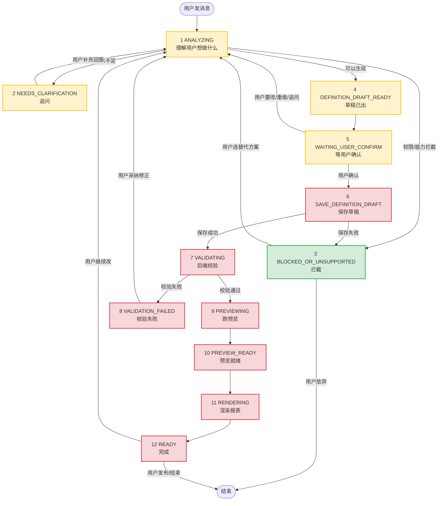
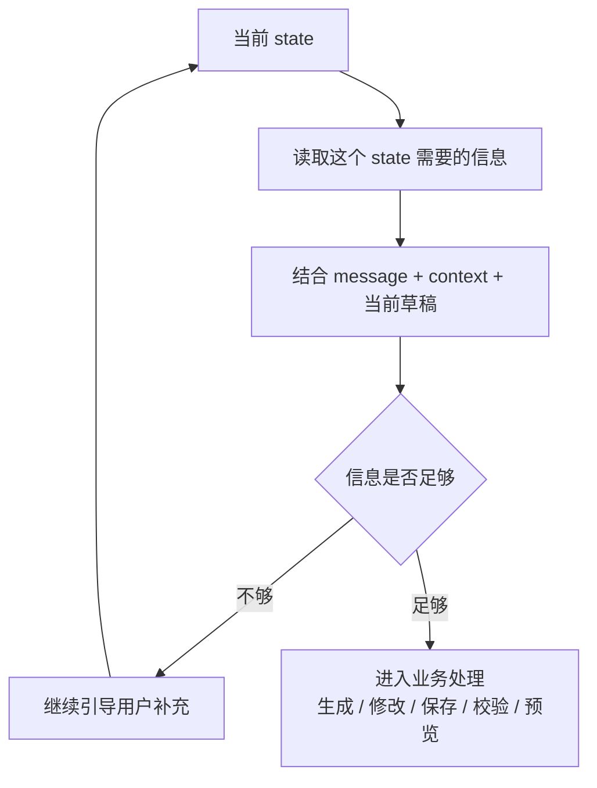

# 功能盘点（按状态机）

> 这份文档从**用户视角**盘点 12 个核心状态要做什么、现在做到哪、还差什么。
>
> 协议字段、接口格式这些放在 `04_AgentScope接入方案.md` 里，不在这里重复。
>
> 阅读顺序：先看状态机全景图 → ContextEngine 全局路由 → 按节点一个个看。

---

## 状态机全景

> 图例：🟩 已跑通 / 🟨 半实现 / 🟥 待实现

---

## ContextEngine 全局路由

ContextEngine 不画进主状态机图里。它是**每次用户发消息后的第一层判断**，负责判断这句话是继续当前流程，还是要打断当前流程。

实际实现分两层：先由轻量 Concierge 承接用户，判断是否需要进入重路由；复杂句子才进入重 ContextEngine。

| 层 | 做什么 | 什么时候返回 |
| --- | --- | --- |
| Concierge 轻量接待员 | 活人感回复、快速判断是否需要重路由 | “你好 / 在吗 / 你能做什么”这类不改变业务状态的话，直接回复 |
| Deep Router 重路由 | 判断是否打断流程、是否缺信息、目标 state 是什么 | 修改、确认、取消、重做、追问当前草稿、危险打断 |
| 业务 Agent / 工具 / Java | 真正生成、修改、保存、校验、预览 | Deep Router 判断可以进入业务处理时 |

**核心规则**

| 规则 | 说明 |
| --- | --- |
| 任意状态收到用户新消息时，先经过 ContextEngine | 不再只服务 `WAITING_USER_CONFIRM` |
| 如果是安全打断，直接跳到目标状态 | 例如等确认时说“昨日总耗电删掉”，可以直接进入修改流程 |
| 如果是危险打断，先进入 `INTERRUPT_CONFIRMING` | 例如后端正在校验、预览正在运行、草稿还没保存 |
| 如果不需要打断，按当前状态正常处理 | 例如追问状态下用户正常补充信息 |

**辅助状态：`INTERRUPT_CONFIRMING`**

这个状态不属于 12 个核心业务节点，是 ContextEngine 的辅助确认状态。它只做一件事：在用户要中断一个正在进行的流程时，先问一句是否确认。

| 当前状态 | 用户说什么 | ContextEngine 判断 | 系统反应 |
| --- | --- | --- | --- |
| `WAITING_USER_CONFIRM` | “昨日总耗电删掉” | 安全打断 | 直接回到 `ANALYZING`，生成修改方案 |
| `VALIDATING` | “我不做了” | 危险打断 | 进入 `INTERRUPT_CONFIRMING`，问是否放弃校验并重新开始 |
| `PREVIEWING` | “重新来” | 危险打断 | 进入 `INTERRUPT_CONFIRMING`，问是否取消当前预览 |
| `RENDERING` | “换成折线图” | 安全打断 | 回到 `ANALYZING`，基于当前报表做修改 |
| `NEEDS_CLARIFICATION` | “算了” | 安全打断 | 结束当前追问，回到初始引导或结束 |

**ContextEngine 输出建议**

| 字段 | 含义 | 例子 |
| --- | --- | --- |
| `userIntent` | 用户真实意图 | `MODIFY` / `CANCEL` / `CONFIRM` / `ASK_QUESTION` |
| `routingAction` | 系统应该怎么走 | `CONTINUE_CURRENT` / `JUMP_STATE` / `ASK_INTERRUPT_CONFIRMATION` |
| `targetState` | 如果要跳转，目标状态是什么 | `ANALYZING` / `READY` |
| `requiresUserConfirm` | 是否需要二次确认 | `true` / `false` |
| `reply` | 需要直接回复用户的话 | “你是想放弃当前校验，重新开始吗？” |

**按当前 state 补齐信息**

ContextEngine 还要按当前 state 判断：这个状态继续往下走需要哪些信息、用户这句话是否已经提供足够信息。如果不够，就停在当前阶段继续引导；如果够了，再进入业务 Agent / 工具 / Java 接口。

| 当前 state | 这个 state 需要什么信息 | 如果信息不够 | 如果信息够了 |
| --- | --- | --- | --- |
| `ANALYZING` | 用户想做什么、对象是谁、时间范围、指标口径 | 进入 `NEEDS_CLARIFICATION`，问缺的对象 / 时间 / 指标 | 调 Agent 生成草稿或修改方案 |
| `NEEDS_CLARIFICATION` | 上一轮追问的答案是否补齐 | 继续追问，但最多追问有限轮数 | 回到 `ANALYZING` 继续处理 |
| `WAITING_USER_CONFIRM` | 用户是确认、修改、重做、追问还是闲聊 | 给候选按钮，不报状态错误 | 确认则保存；修改则回到 `ANALYZING` |
| `SAVE_DEFINITION_DRAFT` | 是否有完整草稿、保存目标、用户确认记录 | 提示用户先确认草稿 | 调 Java 保存接口 |
| `VALIDATING` | 是否已有保存后的定义 ID、校验任务信息 | 等待后端结果，或提示当前正在校验 | 调 / 等 Java 校验结果 |
| `VALIDATION_FAILED` | 校验失败原因、可修复字段、用户是否采纳修正 | 解释错误并问是否采纳修正 | 回到 `ANALYZING` 生成修正方案 |
| `PREVIEWING` | 是否已有校验通过的定义、预览任务 ID | 等待预览结果，必要时提示用户 | 调 / 等 Java 预览结果 |
| `PREVIEW_READY` | 是否有预览数据、是否需要解释或继续渲染 | 提示预览还没准备好 | 进入 `RENDERING` |
| `RENDERING` | 是否有定义和预览数据 | 提示缺少渲染数据 | 前端渲染图表和表格 |
| `READY` | 用户是继续修改、保存、发布、导出还是结束 | 给操作按钮或追问 | 执行对应操作 |

**判断结果建议**

| 字段 | 含义 | 例子 |
| --- | --- | --- |
| `requiredInfo` | 当前 state 继续需要的信息 | `roomId` / `timeRange` / `metric` |
| `collectedInfo` | 已经从对话和上下文拿到的信息 | `{ "roomId": "room_a" }` |
| `missingInfo` | 还缺的信息 | `["timeRange", "metric"]` |
| `isReadyForNextStep` | 是否可以进入下一步 | `true` / `false` |
| `nextQuestion` | 如果缺信息，下一句应该怎么问 | “你想看哪个机房、哪个时间范围？” |

**位置**：`app/services/context_engine.py`，入口在 `agent_service.chat()` 开头。

**现在的实现**：模型版 Semantic Router，输出结构化 JSON；关键词规则只作为模型不可用 / 超时 / JSON 不合法时的兜底。

**和下面节点的分工**

| 原来容易放在节点里的事 | 现在归谁做 | 节点还要不要做 |
| --- | --- | --- |
| 判断用户是确认、修改、重做、提问还是闲聊 | ContextEngine | 节点不用重复判断 |
| 判断当前 state 继续需要哪些信息 | ContextEngine | 节点只消费判断结果 |
| 判断用户这句话是否要打断当前流程 | ContextEngine | 节点不用写一堆 if else |
| 危险打断时先问用户是否确认 | ContextEngine + `INTERRUPT_CONFIRMING` | 节点不用自己处理 |
| 根据缺失信息生成下一句追问 | ContextEngine | 节点 2 负责展示和收集答案 |
| 生成报表草稿 / 修改方案 | 业务 Agent / Skill | ContextEngine 不做 |
| 保存 / 校验 / 预览 / 渲染 | Java / 前端 / 对应节点 | ContextEngine 不做 |

---

## 节点 1 · `ANALYZING`（理解用户意图）

**这个状态做什么**：在 ContextEngine 已经判断过意图和缺失信息后，业务 Agent 真正开始处理：生成草稿、生成修改方案，或者调用权限 / 能力 / 指标相关工具。

**用户体验**

| 序号 | 用户看到什么 |
| --- | --- |
| 1 | 发送消息后看到「正在理解你的意图…」 |
| 2 | 几秒内跳到下一个状态 |
| 3 | 如果只是打招呼或闲聊，AI 像活人一样回应，并给出可点的候选引导语 |

**要实现的功能**

| 序号 | 功能 | 状态 |
| --- | --- | --- |
| 1 | 接收 ContextEngine 的路由结果，进入对应业务处理 | 已完成 |
| 2 | 生成「从零生成报表」草稿 | 已完成 |
| 3 | 生成「修改已有报表」方案 | 待做 |
| 4 | 调用权限 / 能力 / 指标相关工具 | 部分完成 |
| 5 | 不再处理闲聊 / 纯提问 / 是否打断流程 | 已完成（交给 ContextEngine） |
| 6 | 前端显示 loading 文案 | 待做 |

**近期已做**：

| 变更 | 说明 |
| --- | --- |
| 职责收口 | 闲聊、追问、打断判断从节点 1 移到 ContextEngine，节点 1 专心做业务处理 |
| 响应协议扩展 | reply 字段用作对话气泡显示，questions 兼容无 `required`、无 `relatesTo` 的候选引导项 |
| 前端引导卡片 | questions.options 渲染成可点按钮，点一下自动填入输入框并发送 |

---

## 节点 2 · `NEEDS_CLARIFICATION`（信息不足追问）

**这个状态做什么**：ContextEngine 已经判断出缺哪些信息，这个节点负责把追问展示成用户能操作的卡片，并把用户答案带回下一轮。

**用户体验**

| 序号 | 用户看到什么 |
| --- | --- |
| 1 | 看到卡片式追问，不是一串普通文字 |
| 2 | 可以点选项、做多选或选择日期范围，不用手动打字 |
| 3 | 补完之后 AI 继续理解 |

**要实现的功能**

| 序号 | 功能 | 状态 |
| --- | --- | --- |
| 1 | 根据 ContextEngine 的 `missingInfo` / `nextQuestion` 展示追问 | 已完成（基础文本） |
| 2 | 前端支持单选按钮组 | 部分完成 |
| 3 | 前端支持多选复选框 | 待做 |
| 4 | 前端支持文本输入框 | 待做 |
| 5 | 前端支持日期范围选择器 | 待做 |
| 6 | 用户答案自动带回下一轮，不用用户手打 | 待做 |
| 7 | 追问最多 2 轮，避免死循环 | 待做 |

**用户吐槽点**：`needs_clarification` 没引导，主要卡在这个节点。

---

## 节点 3 · `BLOCKED_OR_UNSUPPORTED`（权限/能力拦截）

**这个状态做什么**：用户想做的事情超权限（跨项目）、不被支持（分钟级能力没有）、太危险，AI 解释原因并给替代方案。

**用户体验**

| 序号 | 用户看到什么 |
| --- | --- |
| 1 | 看到红色或黄色提示条，说清楚为什么不能做 |
| 2 | 下面有 2-3 个可点击按钮，例如「改成小时级」「只看本机房」 |
| 3 | 点一下按钮就能继续，不用重新打字 |

**要实现的功能**

| 序号 | 功能 | 状态 |
| --- | --- | --- |
| 1 | 跨项目拦截 | 已完成 |
| 2 | 分钟级能力拦截 | 已完成 |
| 3 | 让 AI 自己产出拦截结果，而不是降级到 FakeAgent | 待做 |
| 4 | 前端把替代方案渲染成按钮 | 待做 |
| 5 | 没有替代方案时显示「结束会话」 | 待做 |

---

## 节点 4 · `DEFINITION_DRAFT_READY`（草稿或修改方案已生成）

**这个状态做什么**：AI 已经生成了完整的报表框架草稿，或者针对老草稿的修改方案。立刻展示给用户。

**用户体验**

| 序号 | 用户看到什么 |
| --- | --- |
| 1 | 看到报表名和几个区域，例如「今日总耗电」「各机架耗电」「小时趋势」 |
| 2 | 每个区域有中文标题、中文指标名、中文单位 |
| 3 | 默认看不到 `regionId / metricRef` 这种技术字段 |
| 4 | 如果是改报表，看到的是 diff 对比：旧的是什么、新的是什么、为什么改 |

**要实现的功能**

| 序号 | 功能 | 状态 |
| --- | --- | --- |
| 1 | AI 产「样例 1」6-region 草稿 | 已完成 |
| 2 | AI 产「修改方案」，例如改 7 天、删趋势图 | 待做 |
| 3 | 新建「修改方案技能」：拿老定义和用户诉求，产出改动清单 | 待做 |
| 4 | 前端只展示中文显示名，不展示技术字段 | 已完成 |
| 5 | 前端增加「查看技术字段」折叠面板，给工程师调试用 | 已完成 |
| 6 | 前端增加修改方案 diff 视图：旧 / 新 / 原因三栏对比 | 已完成（自然语言句子 + 增/删/改色块） |

**近期已做**：

| 变更 | 说明 |
| --- | --- |
| 前端中文词典 | role / 组件类型 / 图表类型 / 单位 / 执行方式 / 允许覆盖 / 状态 全部中文化 |
| 时间窗口翻译 | 把 `{unit:DAY, offset:-1, count:1}` 这种 JSON 翻译成「昨日」「最近 7 天」等 |
| region 友好卡片 | 每个 region 一张卡：role 徽章 + 组件类型 + 时间范围 + 粒度 + 一句话 summary |
| ChangeSet 翻译成人话 | "将「趋势分析」的时间范围调整为最近 7 天"、"删除「趋势分析」" |

**用户吐槽点**：英文和 technical 字段看不懂，主要卡在这个节点（渲染层已修复，待 AI 产修改方案）。

---

## 节点 5 · `WAITING_USER_CONFIRM`（等待用户确认）

**这个状态做什么**：草稿已经展示了，等用户确认是否继续。用户如果说修改、重做、追问或闲聊，由 ContextEngine 先判断并分流；本节点只负责展示确认入口和保持当前草稿。**同时允许用户在预览区直接编辑草稿**（改报表名、改区域名、删区域），编辑后 revision 自增，确认时带着最新草稿去保存。

**用户体验**

| 序号 | 用户看到什么 |
| --- | --- |
| 1 | AI 对话气泡下贴三个按钮：同意 / 修改 / 重新开始 |
| 2 | 右侧预览区的报表名和每个区域名可直接点选编辑，每个区域右上角有删除按钮 |
| 3 | 编辑或删除后立即看到 revision 自增，并出现 toast 反馈 |
| 4 | 点「修改」后输入框聚焦，提示用户直接写下想怎么改 |
| 5 | 点「重新开始」会让 AI 重新生成一版 |
| 6 | 点「同意」后看到「已保存草稿（definitionId，revision=X），下一步进入后端校验。」 |
| 7 | 任何不是明确 yes/no 的消息，都**不会**再出现 `INVALID_STATE_TRANSITION` 报错 |

**要实现的功能**

| 序号 | 功能 | 状态 |
| --- | --- | --- |
| 1 | AI 气泡下三个按钮：同意 / 修改 / 重新开始 | 已完成 |
| 2 | 用户在预览区直接编辑草稿（报表名 / 区域名 / 删区域） | 已完成 |
| 3 | 编辑后 revision 自增，并同步到 session | 已完成 |
| 4 | 用户点「修改」后输入框聚焦提示手写意见 | 已完成 |
| 5 | 判断 CONFIRM / REJECT / MODIFY / 提问 / 闲聊 | 已完成（交给 ContextEngine） |
| 6 | 用户确认后真的调保存服务落库 | 已完成（内存版，待接 Java） |
| 7 | 保存成功后同时发出 `VALIDATE_DEFINITION` toolRequest，为节点 7 校验铺路 | 已完成 |
| 8 | 点「重新开始」清空草稿，重新从头来 | 待做 |
| 9 | 把当前草稿作为 snapshots 带回后端 | 已完成 |

**近期已做**：

| 变更 | 说明 |
| --- | --- |
| 三按钮改版 | 原「确认 / 修改 / 删除 / 重做」四按钮改成「同意 / 修改 / 重新开始」三按钮，直接贴在 AI 对话气泡下，不再占右边大黄卡片 |
| 预览区可编辑 | 报表名、区域名支持 contenteditable，区域可一键删除，revision 自增 |
| 保存服务落地 | 新增 `app/services/definition_save_service.py` 内存版保存，接口形态贴合未来 Java 真实服务 |
| ContextEngine 升级 | `app/services/context_engine.py` 改成模型版 Semantic Router，结构化输出路由决策 |
| agent_service 全局分流 | 所有 state 入站先过 ContextEngine，不再只服务 `WAITING_USER_CONFIRM` |
| 状态机放宽 | 新增 `INTERRUPT_CONFIRMING`，危险打断先二次确认 |

---

## 节点 6 · `SAVE_DEFINITION_DRAFT`（保存草稿）

**这个状态做什么**：用户确认了，AI 发出「去保存」的指令，由 Java 后端落库。AI 自己不保存。

**用户体验**

| 序号 | 用户看到什么 |
| --- | --- |
| 1 | 看到「正在保存草稿…」 |
| 2 | 保存成功后自动跳到校验 |
| 3 | 保存失败回到拦截状态并解释原因 |

**要实现的功能**

| 序号 | 功能 | 状态 |
| --- | --- | --- |
| 1 | 和 Java 对齐保存接口 | 等 Java |
| 2 | 前端拿到「去保存」的指令后调 Java，再把结果回传 | 等 Java |
| 3 | 后端加接口接收 Java 的保存结果 | 等 Java |

**堵点**：等 Java 保存接口。

---

## 节点 7 · `VALIDATING`（后端校验定义）

**这个状态做什么**：定义已保存，Java 后端做 5 类校验：结构 / 字段 / 指标 / 权限 / 能力。

**用户体验**

| 序号 | 用户看到什么 |
| --- | --- |
| 1 | 看到「正在校验报表定义…」 |
| 2 | 校验通过自动跳到预览 |
| 3 | 校验失败跳到校验失败状态 |

**要实现的功能**

| 序号 | 功能 | 状态 |
| --- | --- | --- |
| 1 | 和 Java 对齐校验接口 | 等 Java |
| 2 | 定义错误码表，映射到用户能看懂的提示文案 | 等 Java |
| 3 | 确定校验是同步还是异步 | 等 Java |

**堵点**：等 Java 校验接口。

---

## 节点 8 · `VALIDATION_FAILED`（校验失败待修正）

**这个状态做什么**：Java 返回校验错误，AI 把错误翻译成人话并给修正建议。

**用户体验**

| 序号 | 用户看到什么 |
| --- | --- |
| 1 | 看到「校验失败」提示和具体问题 |
| 2 | 下面有「采纳建议修改」按钮，一键修改 |

**要实现的功能**

| 序号 | 功能 | 状态 |
| --- | --- | --- |
| 1 | 新建「错误翻译技能」：把 Java 错误码翻译成人话 | 依赖节点 7 |
| 2 | AI 自动给出修正方案 | 依赖节点 7 |
| 3 | 前端展示「校验失败 + 修复建议」对比视图 | 依赖节点 7 |

**堵点**：依赖节点 7。

---

## 节点 9 · `PREVIEWING`（发起预览运行）

**这个状态做什么**：校验通过，Java 开始跑真实数据生成预览。

**用户体验**

| 序号 | 用户看到什么 |
| --- | --- |
| 1 | 看到「正在生成预览…」，可能耗时 10-30 秒 |
| 2 | 完成后跳到预览就绪 |

**要实现的功能**

| 序号 | 功能 | 状态 |
| --- | --- | --- |
| 1 | 和 Java 对齐预览接口 | 等 Java |
| 2 | 前端 loading 和超时处理 | 等 Java |
| 3 | 预览失败的降级路径 | 等 Java |

**堵点**：等 Java 预览引擎。

---

## 节点 10 · `PREVIEW_READY`（预览结果就绪）

**这个状态做什么**：Java 返回了预览结果数据，AI 解释结果并提示数据质量问题。

**用户体验**

| 序号 | 用户看到什么 |
| --- | --- |
| 1 | 看到「预览结果就绪」 |
| 2 | AI 附带一段解读，例如「今日总耗电比昨日高 15%，Rack-3 异常是主因」 |
| 3 | 看到数据质量提示，例如「10:00-11:00 有 3 个设备断线，数据可能偏低」 |
| 4 | 自动跳到渲染 |

**要实现的功能**

| 序号 | 功能 | 状态 |
| --- | --- | --- |
| 1 | 定义预览结果的数据结构 | 依赖节点 9 |
| 2 | AI 根据预览结果给出解读 | 依赖节点 9 |
| 3 | 数据质量提示规则 | 依赖节点 9 |

**堵点**：依赖节点 9。

---

## 节点 11 · `RENDERING`（渲染报表预览）

**这个状态做什么**：前端拿到定义和预览结果，渲染成真实的报表（图表、表格、KPI 卡片）。AI 不参与。

**用户体验**

| 序号 | 用户看到什么 |
| --- | --- |
| 1 | 看到完整的报表界面：标题、KPI、图表、表格 |
| 2 | 可以滚动、放大、鼠标 hover 看数值 |

**要实现的功能**

| 序号 | 功能 | 状态 |
| --- | --- | --- |
| 1 | 前端支持 KPI 卡片 | 待做 |
| 2 | 前端支持柱状图 | 待做 |
| 3 | 前端支持折线图 | 待做 |
| 4 | 前端支持表格 | 待做 |
| 5 | 选图表库，例如 ECharts / Chart.js / Recharts | 待做 |
| 6 | 确定组件库和样式规范 | 待做 |

**堵点**：前端工程量较大。

---

## 节点 12 · `READY`（完整预览完成）

**这个状态做什么**：报表已经出来了，用户可以继续改、保存、导出或发布。

**用户体验**

| 序号 | 用户看到什么 |
| --- | --- |
| 1 | 顶部按钮条：继续修改 / 保存 / 发布 / 导出 PDF 或 Excel |
| 2 | 可以直接打字继续调整 |

**要实现的功能**

| 序号 | 功能 | 状态 |
| --- | --- | --- |
| 1 | 扩展按钮集合：edit / save / publish / export / share | 依赖节点 11 |
| 2 | 点「继续修改」回到理解意图状态，保留当前报表作为基础 | 依赖节点 11 |
| 3 | 发布流和导出流后续单独设计 | 依赖节点 11 |

**堵点**：依赖节点 11。

---

## 现状一览

| 节点 | 核心缺口 | 堵点 |
| --- | --- | --- |
| 0 ContextEngine 全局路由 | 模型版 Semantic Router 已接入，需补回归案例 | 无 |
| 1 ANALYZING | 修改意图识别、追问意图识别 | 无 |
| 2 NEEDS_CLARIFICATION | AI 产追问 + 前端卡片组件 | 无 |
| 3 BLOCKED_OR_UNSUPPORTED | AI 自己产拦截 + 前端替代方案按钮 | 无 |
| 4 DEFINITION_DRAFT_READY | AI 产修改方案（渲染层已完成） | 无 |
| 5 WAITING_USER_CONFIRM | 占位确认接口 + 带当前草稿 | 无 |
| 6 SAVE_DEFINITION_DRAFT | 保存接口 | 等 Java |
| 7 VALIDATING | 校验接口 | 等 Java |
| 8 VALIDATION_FAILED | 错误翻译 | 依赖 7 |
| 9 PREVIEWING | 预览接口 | 等 Java |
| 10 PREVIEW_READY | 结果解读 | 依赖 9 |
| 11 RENDERING | 前端图表渲染器 | 前端工程 |
| 12 READY | 扩展按钮集合 | 依赖 11 |

**节点 1-5 现在就能干，不等任何人。节点 6-10 等 Java。节点 11-12 等前端。**
